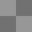
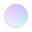
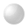
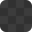
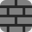

# Spline icons → glTF Inspector

Where the icons exported to `~/Downloads/spline-icons/` (contact sheet: its `index.html`) fit in the
app. Each row shows the icon the app draws **today** (SF Symbol) next to the **Spline** one.
Source: two saved snapshots of Spline's editor (Blocks Flow), 4 Nov 2026.

## Before using any of them

- **They are Spline's artwork.** Use them as a reference, or get permission before bundling them.
- **The app's icon rule is "SF Symbols only".** `DSTypeIcon` and DESIGN.md ("System first") say
  icons track the system font, with no bundled artwork. Where SF Symbols has no glyph (normal map,
  cavity, torus, icosahedron…), draw our own as **custom SF Symbol templates** in the asset catalog
  (`Image("torus")`), so weight and tint still follow the system. No loose PNGs or SVGs.

## 1. Identifying primitives: yes, mostly

A glTF file has no "cube" field, but we can usually tell from what it does carry:

1. **Name.** Spline, Blender and most exporters keep the object name: this file has `Cube 4`,
   `Long Cube`, `Cylinder`, `Ellipse`, `Triangle`. Match whole words in the node and mesh name
   (`cube`, `box`, `sphere`, `cylinder`, `cone`, `torus`, `plane`…), ignoring suffixes like `.001` and ` 4`.
2. **Geometry.** Weld duplicate positions and test the shape (table below). The bounding box comes
   free from the `POSITION` accessor's `min`/`max` in the JSON. The shape tests need the vertex
   positions, so run them only on small meshes (under ~5 000 vertices) while the renderer loads the
   buffers, and hand the result to the outliner.
3. **Rule.** For a shape we can test (cube, sphere, cylinder…) the icon needs the geometry to agree.
   A name alone never wins, so a sculpt called `Cube.003` keeps the generic icon. For shapes we
   can't test (teapot, bunny, knot, text) the name alone decides. Anything else keeps today's cube.

| Primitive | Today | Spline | How to tell |
| --- | :-: | :-: | --- |
| Cube, box ("Long Cube") |  |  | 8 unique corner positions, all on the bounding box |
| Plane |  |  | 4 unique positions; one bounding-box side ≈ 0 |
| Sphere |  |  | every position the same distance from the centre (±1 %) |
| Cylinder |  |  | two cap heights along one axis; constant radius around it |
| Cone |  |  | radius falls linearly to one apex point |
| Pyramid |  |  | 5 unique positions |
| Icosahedron |  |  | 12 unique positions, all equidistant |
| Dodecahedron |  |  | 20 unique positions, all equidistant |
| Torus |  |  | every position the same distance from a ring |
| Torus knot, helix, lathe |  |    | name only |
| Teapot, bunny |  |   | name only |
| 2D shapes: rectangle, ellipse, triangle, pentagon, star |  |      | name; geometry check: one thin bounding-box side (flat or a shallow extrusion) |
| Text |  |  | name only |
| Line / path mesh (`mode` 1–3) |  |  | primitive `mode`, a fact in the JSON |
| Point cloud (`mode` 0) |  |  | primitive `mode` |
| Any other mesh |  |  | fallback: today's generic cube |

Spline's 2D shapes export as thin extruded meshes, so they usually need the name. A primitive's
`mode` (points / lines / triangles) is plain JSON, so line and point meshes are the easiest win.

## 2. Groups: drop the folder

Today an empty node with children shows  `folder` in the glyph slot, and swaps to
 on hover to fold.

Spline actually keeps both: a boxed chevron column on the left, plus a type icon. A plain group
(its "Marker Cap" row) gets , and a boolean (Bridge) gets .

**Recommendation:** for an **empty group**, put the chevron in the glyph slot all the time
( folded /  open) and drop the folder, as you suggest. The chevron already says
"holds things", and a separate icon would be noise. A **mesh, camera or light with children** keeps
its type icon and swaps to the chevron on hover as today, because its type is the more useful fact.
This is a change to `DSOutlineRow` / `DSTypeIcon` only, plus keyboard and VoiceOver labels.

## 3. Outliner: other object types

| Row | Today | Spline | Notes |
| --- | :-: | :-: | --- |
| Camera |  |  | Same glyph. Keep SF `video`. |
| Directional light |  |  | `Light.type == "directional"`. Data already there. |
| Point light |  |  | `Light.type == "point"`; SF `lightbulb`  |
| Spot light |  |  | `Light.type == "spot"`; SF `lamp.desk`  |
| Mesh instance (2+ nodes share a mesh) |  |  | New: count shared `meshIndex`. Shows reused geometry. |
| Animation |  |  | Stopwatch reads as time; SF `stopwatch`  |
| Scene (default `scene`) |  |  | Spline marks the start scene with a house; SF `house`  |
| Empty leaf node |  | – | No Spline equivalent; keep. |
| Material |  | – | Keep; see Materials for swatches. |
| Skin / morph |   | – | No Spline equivalent; keep. |
| Boolean (Spline only) | – |   | No glTF equivalent. |

## 4. Row controls, sidebar, toolbar

| Control | Today | Spline | Notes |
| --- | :-: | :-: | --- |
| Visibility toggle |   |  | Spline's half-open eye is lighter; keep `eye` for familiarity. |
| Fold chevron |  |  | Same; keep the system chevron. |
| Lock | – |   | Not needed: the viewer is read-only. |
| Sidebar toggle (Cmd-B) |  |  | Same glyph. |
| Outliner search |  |  | Same glyph. |
| Outliner filter by type |  |  | If a type filter ships. |
| Perspective / orthographic |  |  | Spline's box reads as "3D view" more plainly. |
| Performance readout | – |  | Only if a stats overlay ships; SF `waveform.path.ecg`  |

## 5. Materials

Every view-mode channel uses  today, and texture-slot rows have no icon. Spline's material
layer icons fit best here: one `TextureSlot.Kind` / `RenderViewMode.Channel` → icon table can serve
both the `MaterialSection` map rows and the View Mode menu.

| Slot / channel | Today | Spline | Why |
| --- | :-: | :-: | --- |
| Base colour |  |  | Real `thumbnailPNG` when there is one, this when not. |
| Normal |  |  | The purple–blue normal sphere is universal. |
| Occlusion |  |  | Cavity = crevice darkening = AO. |
| Metallic / roughness |  |  | Shaded sphere = surface response. |
| Emissive |  |  | Glowing ring. |
| Specular, spec-gloss workflow |  |  |  |
| Clearcoat (+ roughness, normal) |  |  | Glossy shell; add a modifier for roughness / normal. |
| Alpha, mask / blend |  |  | Checkerboard = transparency. |
| UVs |  |  | Tiling hints at UV layout. |
| Vertex colours (`hasVertexColors`) | – |  | Chip in Geometry; flag already exists. |
| Unlit workflow | – |  | Flat shading. |
| Tangents |  | – | No Spline equivalent. |
| Wireframe view mode |  | – | Keep. |
| Material header swatch |  |  | A sphere in `baseColorFactor`, drawn in SwiftUI. |

## 6. Not useful in a viewer

Editing tools with nothing to drive them: toolbar pen / comment / design cursor, particles, hair,
shape blend, decal, input, templates, new scene, add modifier, material unlink / palette, pin
preview, dialog close, number-field and lock baubles, `radio-boolean-*`, drag-and-drop event,
AI texture  and its badge , resize cursor, favicon.

## Icon check (4 Nov)

Every inline SVG in both snapshots now has a file. Fixes in this pass:
`outliner-type-boolean` → `outliner-type-boolean-intersect` ("halfmoon"),
`outliner-type-boolean-2` → `outliner-type-boolean-subtract` ("Bridge"). I also added two
glyphs the first pass missed: `material-layer-ai-texture` and `badge-ai-lightning`. Some files share a glyph under
two names because Spline reuses it, e.g. `outliner-type-group` = `add-menu-group` and
`outliner-type-cube` = `toolbar-create-3d-object`.

## Suggested order

1. **Groups without the folder** (section 2): small, and it's the change you asked about.
2. **Light subtypes**: directional / point / spot from `Light.type`.
3. **Line / point meshes** from primitive `mode`, then **name + geometry primitives**.
4. **Material and channel glyphs**: one shared table; draw custom symbols for normal, cavity and vertex colour.
5. **Mesh instances** from shared `meshIndex`.
