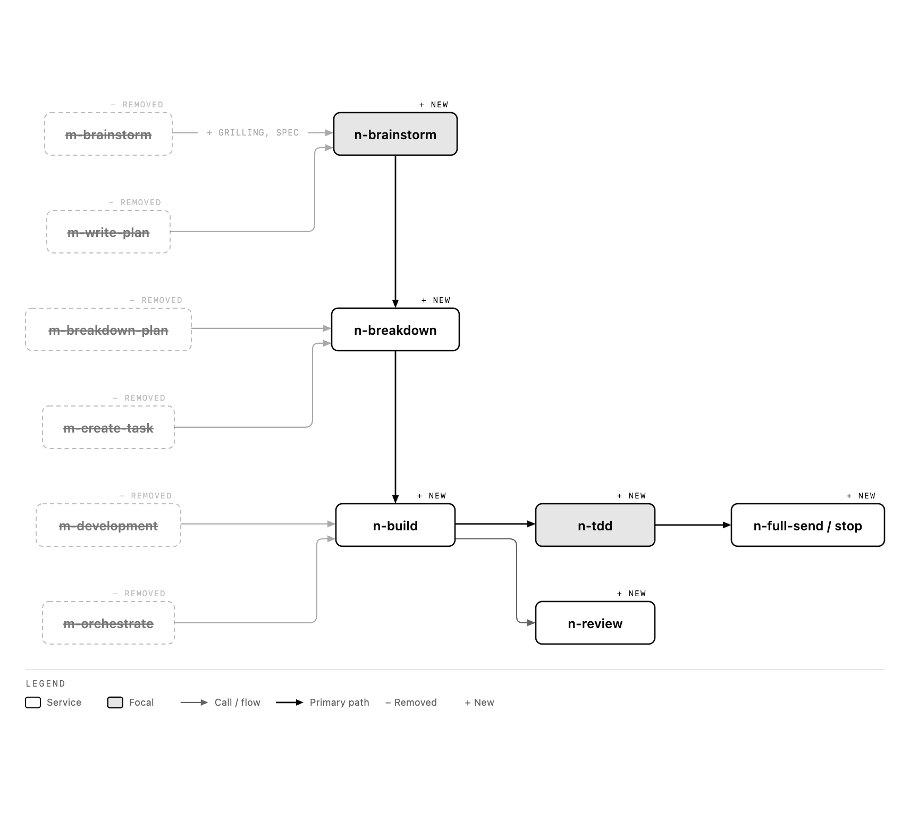

# m-workflow → next-workflow

Nothing here has been applied to `~/.agents/plugins/m-workflow`. This is the list to approve. The `n-` drafts in this folder show each change.

**Size:** the m- skills, references and agents that this replaces come to about 15,000 words. Their n- replacements come to about 5,000, not counting the visual companion's server and guide.
Skill files, agents, and `WORKFLOW.md` are the instructions. This file is the draft log.

## Decisions taken from your feedback

| You said | What the draft does |
| --- | --- |
| Lean on superpowers' brainstorm and visual companion; combine with grilling and spec | `n-brainstorm`: *why* first (superpowers' open questions), then grilling rounds over the design tree (Matt), then approaches, spec, builder check and approval. The visual companion is vendored, with its remote logo/telemetry image switched off. |
| Backlog words are epic, task, subtask (L0–L2) | Everywhere: skills, agents, glossary, diagrams. Gone: "slice", "ticket", "step", "lane". |
| Breakdown turns a plan into tasks and subtasks | `n-breakdown` breaks a spec *or an existing plan* into tasks and subtasks. A plan is never rewritten. |
| Board always up to date; no ledger; record off-plan work as a completed task | Board rules in the bootstrap, enforced by the `task-guard` hook. The hook re-injects in-progress tasks after compaction. The board is the history; there is no separate ledger. |
| No code change without a task | The `task-guard` hook denies Edit/Write on code while no task is in progress, in repos with a dex board. Docs, `.agents/` and other scratch paths are exempt. |
| One of writing-skills / writing-for-agents | Merged into one global `writing-skills`: Matt's writing rules plus superpowers' red/green test cycle, with a Codex test runner. `writing-for-agents` is removed. Dead links are gone, because the merged skill no longer depends on `superpowers:test-driven-development` or `using-superpowers/references`. |
| No PRs; merge into main when the worktree is ready | Detached worktrees in `.worktrees/`. Landing is rebase → fast-forward `main` → remove the worktree. No GitHub involved. |
| Launch the app and the user approves | `n-full-send`: prove → Sol → launch → ask → land on main → complete. |
| Use OpenAI for testing skills | `skill-test.sh` runs every scenario on Codex (gpt-6.1-sol), which is a fresh context and a different model from the author, and grades it with a second Codex call. Each n- skill also ships `agents/openai.yaml` so Codex lists it. |
| Plugin `next-workflow`, prefix `n-` | Done: the plugin, 9 skills and 4 agents. |
| Never say dex; always the Atelier backlog | Every `dex` is gone from the draft. Commands use the `backlog` CLI; the MCP server is `backlog` (`create_task`, `update_task`, `list_tasks`). New `n-backlog` replaces the old `dex` skill. Both hooks call `backlog`. |
| Agent artifacts in `.atelier/`; per-task scratch in `.atelier/tasks/<id>/` | `n-backlog` owns the path table: per task `.atelier/tasks/<id>/` (any mess inside), research `.atelier/research/`, unscoped captures `.atelier/artifacts/`. Reports, review diffs, captures and diagrams all go there. |
| Plans are written directly as L0 epics, with rich formatting | The spec *is* the L0 epic's description ([epic template](skills/n-backlog/references/epic-template.md)): a picture first, then why, decisions, acceptance examples, seams. A written plan is put on an epic as it is. No more spec files. `n-backlog/references/formats.md` covers the pictures: live demos, `create-diagram` / `create-wireframe` / `create-anatomy` embedded as webviews, and before/after captures. No mermaid or json-graph. The most visual thing sits at the top of every description and result. |
| Keep `.atelier/` synced to GitHub | The rule is in `n-backlog` (commit `.atelier/` with the work). In this repo I removed `.atelier/` from `.gitignore`; it is 3 MB and **untracked, not committed**. |
| Capture before/after; diagrams, dimensional drawings, visual templates | `n-execute` and `n-subagents` capture `before` when a visible task starts; `n-full-send` captures `after` with the same framing; results open with the picture. Every L0 opens with a diagram. |
| atelier-lm: Jev and Qwen for easy things | `n-subagents/references/dispatch.md` routes yes/no, choice and score jobs to Jev, and easy text to Qwen, before any coding model. |
| Handoff path | `.agents/tmp/handoff/<YYYY-MM-DD-HHMM>-<project>.md` |
| Cursor + Codex subagents; background visualizer; less text in agents | Agents are now thin (≈1,000 → ≈470 words for five), and their procedures moved into skill references (`n-review/references/task-review.md`, `epic-review.md`, `n-brainstorm/references/builder-check.md`, `n-subagents/references/dispatch.md` § Implementer report). New **`n-visualizer`** (`is_background: true`) makes a picture and puts it on top of the task while the parent keeps going. `scripts/sync-agents.py` turns one Markdown source into Cursor/Claude symlinks plus Codex TOML. |
| No mermaid or json-graph; pictures first; keep the task current | All pictures come from `create-diagram`, `create-wireframe`, `create-anatomy`, captures, or a live demo, embedded as webviews or images. The most visual thing goes at the very top of every description and result. Every artifact goes onto its task the moment it exists. Scenario `tests/n-backlog/result-picture-first.md` waits for the Codex re-run. |

## Where I took your ideas with a grain of salt

- **Grilling vs "one question at a time".** The two clash. Asking one open question at a time is better for *why* (options steer); grilling rounds are better for *decisions* (fast, each with a recommendation). `n-brainstorm` does them in that order instead of picking one.
- **Board-only, no ledger.** Right for state, but compaction still loses the conductor's place, so the hook prints in-progress tasks and live worktrees after compaction. That covers it without a ledger file.
- **Native worktree tools.** Claude's `EnterWorktree` creates a branch under `.claude/worktrees/`. You want in-repo worktrees with no branches, so the draft always uses `git worktree add --detach .worktrees/<task-id>`.
- **Completion moment.** "Completed when code is accepted" means the user approved the running app *and* it is on `main`.

## Per skill (m- → n-)

| m- (words incl. refs) | Problems found | n- |
| --- | --- | --- |
| `using-m-workflow` (613) | The hook only points at it. No router by artifact, no board rules, no laws. Mermaid in a file that says "no Mermaid". | `using-next-workflow` (≈390), injected in full |
| `m-orchestrate` (513) | Repeats the bootstrap's table. No per-task review, fix-loop limit, or parallel rule. | Merged into the bootstrap + `n-build` |
| `m-brainstorm` (982) | No grilling rounds, no approaches message, no spec, no builder check. Peer scan is product research. "Stop for approval" contradicts "continue if authorized". | `n-brainstorm` (≈520 + refs) |
| `m-write-plan` (463) | A plan with no tests or acceptance examples, then repeated in the tasks | Removed as a stage. A spec replaces it; existing plans are input to `n-breakdown` |
| `m-breakdown-plan` (≈5,400) | Bloated references; "horizontal slicing" means the opposite of what the file says. No acceptance-test mapping. | `n-breakdown` (≈300 + 2 refs) |
| `m-create-task` (≈2,950) | Mostly capture and webview mechanics; verification is checked after the fact | `n-breakdown/references/task.md` |
| `m-development` (≈1,400) | No TDD, no report contract, no review gate, no landing | `n-build` + `n-tdd` + `n-full-send` |
| — | No TDD anywhere in the plugin | `n-tdd` (iron law, bug branch, good tests, root cause) |
| — | No review loop | `n-review` + `n-task-reviewer` |
| `dex`, `m-research`, `m-explainer`, `m-simplify-code` | Fine, or out of scope | Kept as they are |

## Skills, one job each

Skill files do not record where a rule came from. That note is on the backlog.

| Skill | Job |
| --- | --- |
| `n-tdd` | Red, green, refactor. One behaviour per test. |
| `n-worktrees` | Detached `.worktrees/<id>`. Detect an existing worktree. Land onto `main` only from `n-full-send`. |
| `n-parallel` | Independent tasks or failures, dispatched in one message. Shared files wait until the earlier worktree has landed. |
| `n-execute` | This session, one task at a time, when there is no subagent or the user said not to use one. |
| `n-subagents` | One `n-implementer` per task, then `n-task-reviewer`, then land. Conductor writes no product code. |
| `n-build` | Picks `n-execute` or `n-subagents`. |
| `n-verify` | Fresh command output before any pass, fixed, or done claim. |
| `n-review` | `n-task-reviewer` or `n-code-reviewer`, then act. |
| `n-sol-loop` | One Sol reviewer, local diff against `main`, before the user approves. No substitute model. |
| `n-full-send` | Prove, Sol, launch, ask, land, complete. Testing permission included. No land without approval. |

## Agents

**Sync done this session:** `~/.codex/agents/*.toml` regenerated from `~/.agents/agents/*.md`. The four old snapshots had drifted from their sources, and `fast-worker` was missing in Codex (it now has `codex_effort: low`). Backup of the old TOMLs is in the session scratchpad. Cursor already linked all five global agents. The draft n- agents are project-scoped in this repo: `.agents/agents/` (Cursor via `.cursor/agents`) and `.codex/agents/`.

| m- | Problem | n- |
| --- | --- | --- |
| `task-implementer` | No TDD evidence, report file, or "no subagents" rule; garbled run-on paragraph | `n-implementer` |
| `code-reviewer` | No severities, no spec pass, no handling of deferred minor findings | `n-code-reviewer` (whole epic) |
| — | No per-task gate | `n-task-reviewer` (spec ✅/❌ + quality ✅/❌) |
| — | Pictures block the parent | `n-visualizer`, background: diagram, wireframe, capture or demo, put on top of the task |
| `plan-reviewer` (611) | Rewrites plans in place through 8 steps | `n-spec-reviewer` (builder check: questions only) |
| `researcher` | Fine | Kept |

## Hooks

| Hook | Does | Tested |
| --- | --- | --- |
| `session-start` | Injects `using-next-workflow` in full. On compact/resume/clear, also lists in-progress tasks and `.worktrees/`. | Output is valid JSON, ≈2.3k chars |
| `task-guard` | PreToolUse on Edit/Write/MultiEdit/NotebookEdit: denies code edits when no task is in progress | Denies with none in progress; allows once one starts; ignores `.md`, `.agents/`, paths outside the repo, and repos without a board |

## Skill tests (Codex, 3 reps each)

**Status, Nov 4 23:55:** Codex hit its usage limit partway through the full run (resets **Nov 5, 04:17**). Re-run with `bash tests/run.sh`. The table below separates proven, partial and pending.

Each scenario ran 3 times on Codex (gpt-6.1-sol), once without the skill and once with it, and a second Codex call graded each answer against the scenario's `PASS:` line. Scenarios are in `tests/`.

| Skill / agent | Scenario | Without | With | Verdict |
| --- | --- | --- | --- | --- |
| `n-tdd` | Crash bug, "skip tests, demo in 10 min" | 0/3 | **3/3** | Proven (earlier run; wording since changed only dex → backlog) |
| `n-brainstorm` | "I want some kind of measuring feature" | 0/3 | **3/3** | Proven (earlier run; since then the spec moved onto the epic) |
| `n-breakdown` | Existing plan → board | 0/3 | **3/3** | Proven after one fix (earlier run) |
| `using-next-workflow` | Edit with no task; side fix mid-task | 3/3, 3/3 | 3/3, 3/3 | Not needed as text on Codex; the `task-guard` hook enforces it |
| `n-backlog` | "Write the spec down" | 0/1 | 1/1 | Promising; cut short by the limit |
| `n-task-reviewer` | Missing whitespace case + unrequested menu item | 2/2 | 2/2 | Base model already catches both; the definition adds format, not catches |
| `n-code-reviewer` | Background-queue data race | 1/1 | 2/2 | Same: base model already catches it |
| `n-implementer` | Red before green with evidence | 1/1 | — | Pending; the brief itself already says "red first" |
| `n-spec-reviewer` | Spec that leaves everything to the builder | 0/0 | **0/1** | **Defect found and fixed:** "skip what the spec leaves to the builder" made it answer "nothing important left". Now user-visible decisions are always asked. Needs a re-run. |
| `n-build` | Parallel worktrees; review gate | — | — | Pending (limit) |
| `n-review` | Wrong reviewer finding | — | — | Pending (limit) |
| `n-full-send` | Land after approval | — | — | Pending (limit) |
| `n-visualizer` | Picture goes on top, rest kept | — | — | Pending (limit) |

**Rig bugs found and fixed along the way:** the grader read Codex's echoed prompt; the grader failed answers for "not really running" commands; and two pass lines contradicted the skills. That is why every pass line is now checked against its skill (see `writing-skills/references/testing.md`).

**What the reviewer results mean:** for the two reviewer agents, Codex already reviews well without them. Keep their definitions short: they fix the output shape and the severity words, nothing more.

## Held back until a real failure asks for them

- A hook that checks the task result carries proof before `dex complete`
- A guard stopping the conductor from editing product code while agents run (superlite's `_edits`)
- Domain modelling (ADRs), prototype, and Matt's multi-session `wayfinder`
- Superlite's plan lint, size bands and Python CLI

## Global skills (`~/.agents/skills`)

| Skill | State |
| --- | --- |
| `writing-skills` | Merged (Matt + superpowers). References: `skill-mechanics.md`, `testing.md`, `bulletproofing.md`. Script: `scripts/skill-test.sh` (Codex). It takes a skill folder or an agent `.md`, and stops with `BLOCKED` when Codex hits its usage limit. |
| `writing-for-agents` | Removed (merged into the above). A backup of both originals is in the session scratchpad. |
| `handoff` | Writes to `<repo>/.agents/tmp/handoff/<YYYY-MM-DD-HHMM>-<project>.md` |
| `wait-what` | Word for word. Needs a `GLOSSARY.md`; promoting next-workflow should add a root glossary to repos that use it. |
