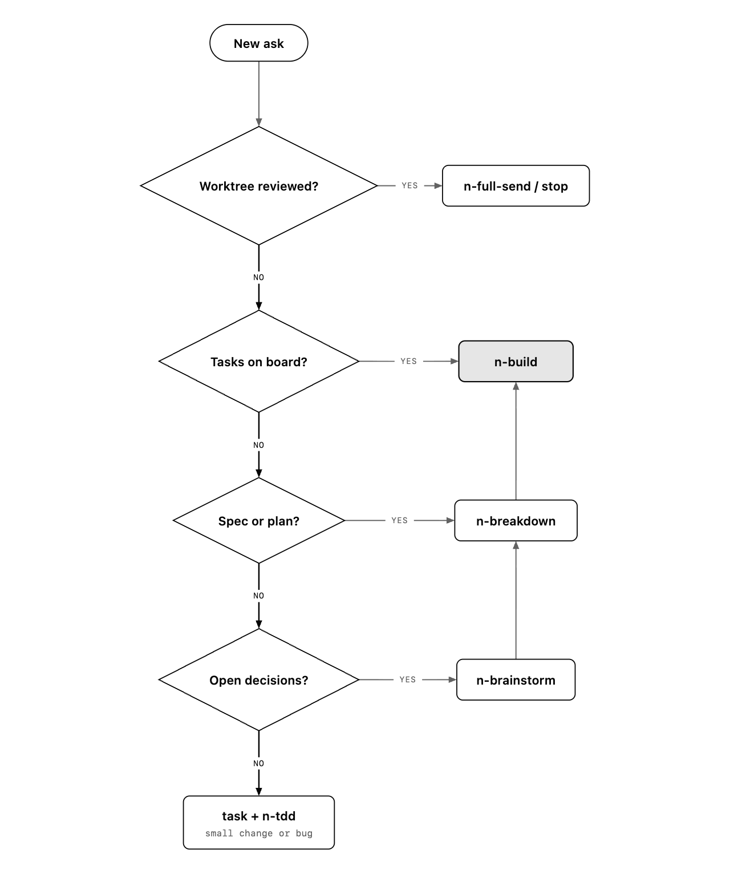
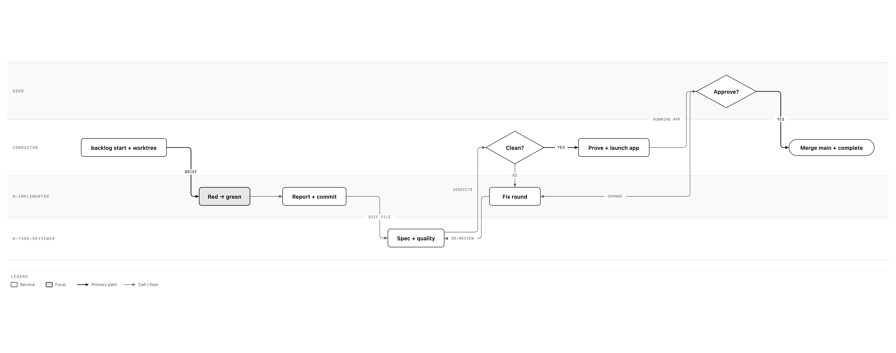
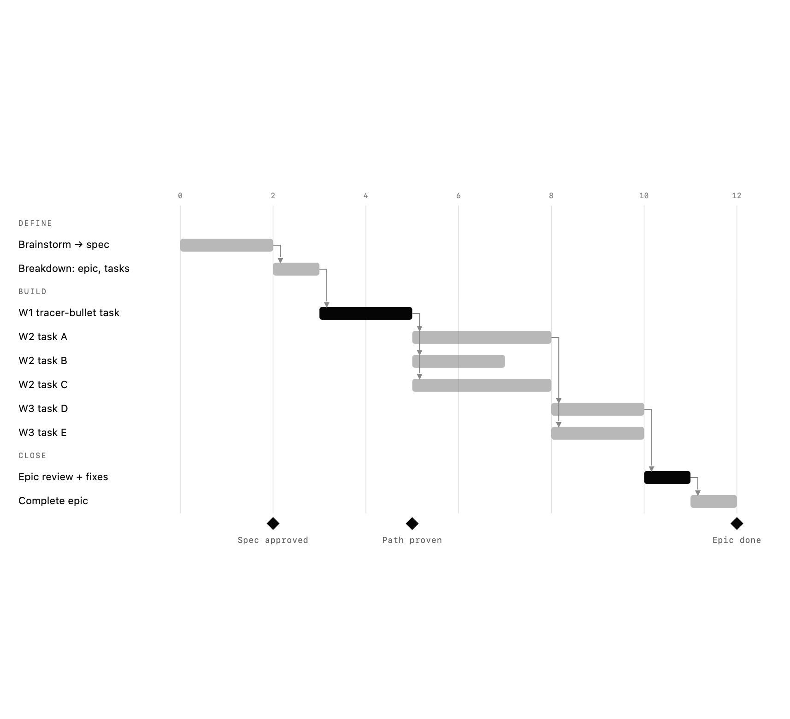

# How next-workflow runs

```text
brainstorm → breakdown → build (red → green → refactor) → review → land
```

Words follow [GLOSSARY.md](GLOSSARY.md). Each picture has an interactive HTML twin in `diagrams/`.

## 1. Enter where the work is

You never redo a stage whose artifact exists. A written plan goes straight to `n-breakdown`. Tasks on the board go straight to `n-build`.



## 2. The same spine at any size

| Size | Brainstorm | Board | Build | Review | Land |
| --- | --- | --- | --- | --- | --- |
| Small change ("icon blue") | — | one-off task | `n-execute` + `n-tdd` | self, say so | full send |
| Bug | — | one-off task | red repro → fix | `n-review` | full send |
| Feature | short spec | task + 1–6 subtasks | `n-execute` or one worktree | task review | full send |
| Project (≤50 tasks) | full spec + builder check | epic → tasks → subtasks, in waves | `n-subagents` in worktrees | task review each + epic review | full send per task |

## 3. One task, start to land

The board changes at every hand-off: `backlog start` when work begins, rulings and results as they happen, `backlog complete` only after the user approves the running app and the code is on `main`. No PRs: the worktree lands straight on `main`.



## 4. An epic over time

Wave 1 is the tracer-bullet task: it proves the path through every layer before anything fans out. In later waves, tasks whose files don't overlap run in parallel worktrees.



## 5. The board is the truth

| Moment | Board action |
| --- | --- |
| Task starts on something visible | `before` capture in `.atelier/tasks/<id>/captures/` |
| About to edit code | A task is in progress, or you start or create one. `task-guard` blocks the edit otherwise. |
| Work begins | `backlog start` |
| A decision instead of a stall | `Ruling: …` written on the task |
| Review finds new work | A new task under the epic |
| Off-plan work happened anyway | A task created and completed at once, so history is whole |
| Code accepted (approved and on `main`) | `backlog complete` with `after` capture (or diagram) first, then proof |
| Context compacted | The hook re-injects in-progress tasks and live worktrees |

## 6. Hand-offs between people and sessions

| Situation | Use |
| --- | --- |
| New session or person | `/handoff` → `.agents/tmp/handoff/<date-time>-<project>.md`, pointing at the epic, tasks and commits |
| A message didn't land | `/wait-what`: re-pitch in simple English, using glossary words |
| Spec changes mid-build | Change the spec first, then a ruling on the epic, then new or changed tasks |

## 7. Who does which job

| Job | Seat |
| --- | --- |
| Yes/no, pick one, score | Jev (atelier-lm) |
| Easy text: commit message, task name, a quick read of a one-file diff | Qwen (atelier-lm) |
| Code from an exact brief | fast worker (`fast-delegation`) |
| Code needing judgment; reviews | standard model |
| Stuck fixes, epic review, architecture | strongest model |
