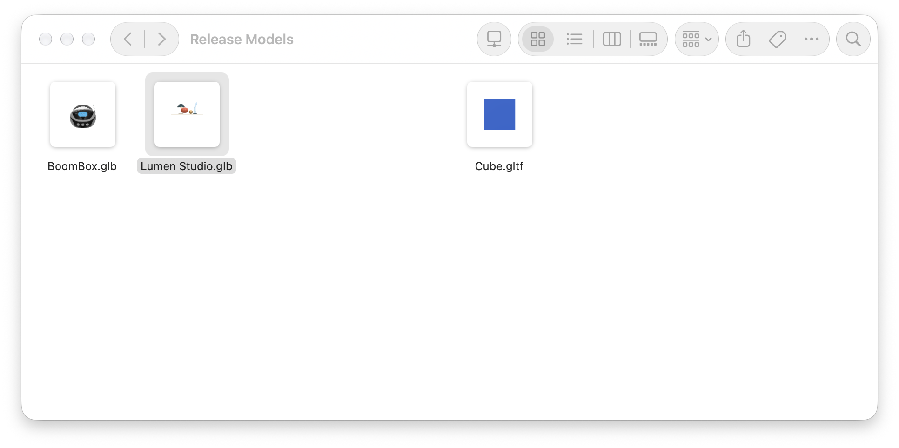
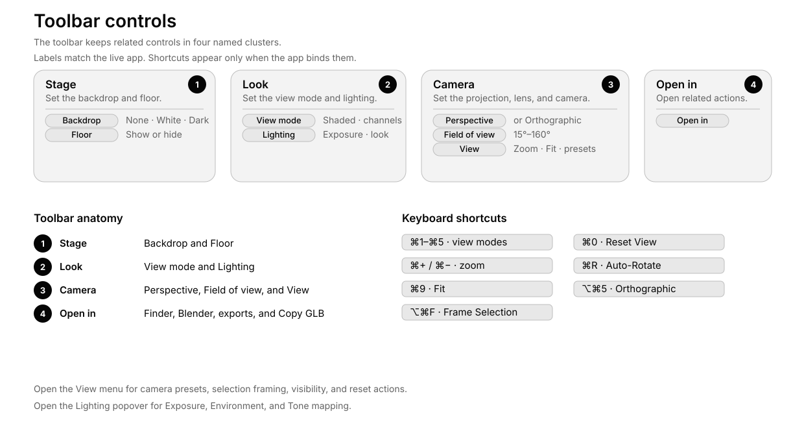
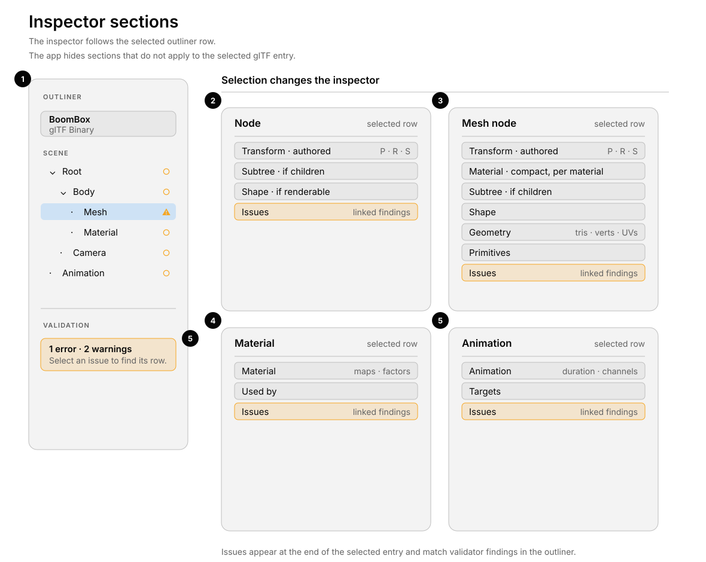
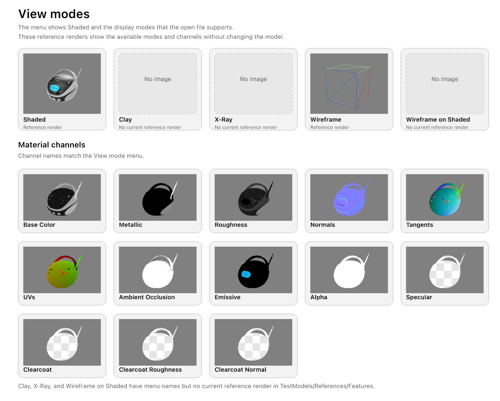
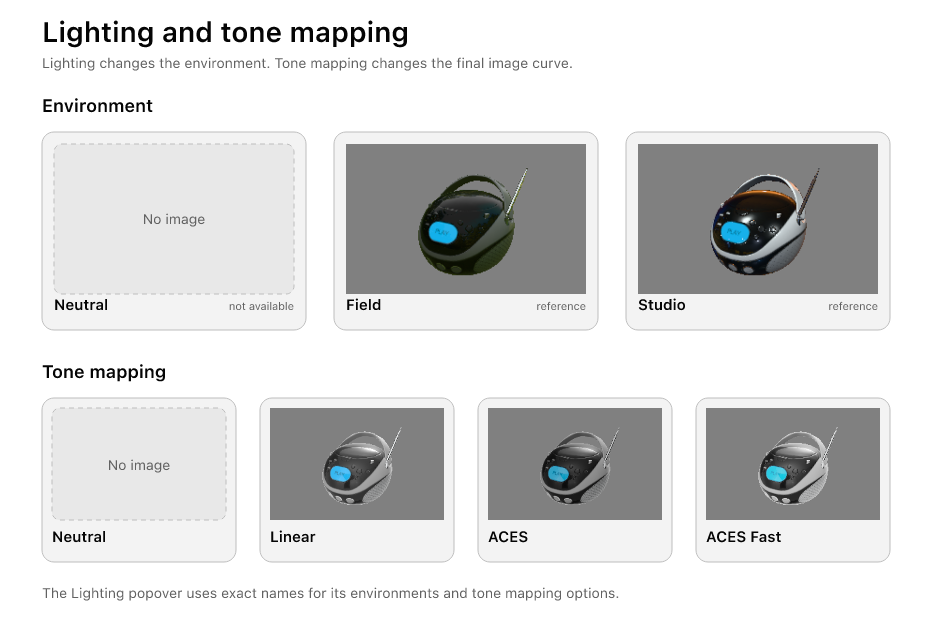
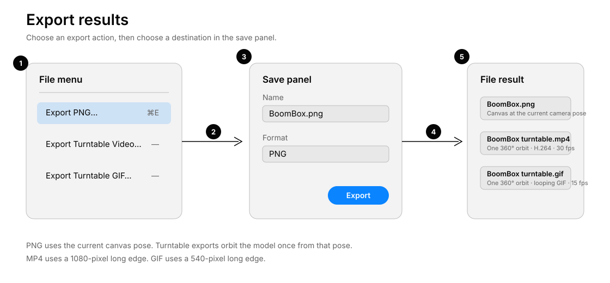

<p align="center">
  
</p>

<h1 align="center">macOS glTF Inspector</h1>

<p align="center">
  <strong>Native App and Finder Support for <code>.glb</code> and <code>.gltf</code></strong><br>
  Inspector App, Thumbnails, Quick Look and Preview Pane — rendered in Metal with shading hand-ported from the <a href="https://github.com/KhronosGroup/glTF-Sample-Renderer">Khronos glTF Sample Renderer</a>
</p>

<p align="center">
  <br>
  <small>Viewer App</small>
</p>

<table>
  <tr>
    <td align="center" valign="top" width="33%">
      <br>
      <small>Thumbnails</small>
    </td>
    <td align="center" valign="top" width="33%">
      <br>
      <small>Quick Look</small>
    </td>
    <td align="center" valign="top" width="33%">
      <br>
      <small>Preview Pane</small>
    </td>
  </tr>
</table>

The same native Metal renderer draws the model in the app, in Quick Look and in Finder. The viewer does
not edit the source model. Quick Look and thumbnails use the rest pose, without the app
window’s hide/solo state; Quick Look rotates the camera automatically. In the app window you can also:

- browse the scene in an outliner and read each node, mesh and material in the inspector
- see the Khronos glTF-Validator's findings, linked to the outliner rows they concern
- hide, solo and click-select nodes; frame the selection
- play an animation clip on a timeline: scrub, loop and change speed
- switch lighting, file cameras and view modes (Shaded, Clay, X-Ray, Wireframe, or one material channel such as normals or roughness)
- export a PNG, or a turntable as MP4 or GIF

## Scope and limits

This is a glTF 2.0 viewer with selected extension support, not a claim of complete glTF
conformance. Reference tests check a pinned set of models, poses and looks within pixel-error
budgets; they do not prove identical rendering for every file or device.

Animation playback evaluates node translation, rotation, scale and morph weights. Animation
pointer targets are currently ignored. The Khronos validator checks the file, not the viewer’s
rendering or extension coverage; validation is skipped for source files over 48 MiB.

## Install

1. Download [glTFInspector.zip](https://github.com/Hemmingsson/macos-gltf-inspector/releases/latest).
2. Move `glTF Inspector.app` to `/Applications`.
3. Control-click → **Open** (or allow under **System Settings → Privacy & Security**).
4. Open the app once so the Quick Look preview and thumbnail extensions load.

### Finder support


Open the installed app once. Check these registered extensions:
`lol.mattias.gltf-inspector.PreviewExtension` and
`lol.mattias.gltf-inspector.ThumbnailExtension`.
Quick Look shows a live preview. Finder thumbnails show one image.
Both need an installed app and readable model files. For `.gltf`, keep each referenced
`.bin` and texture file beside the model.

## Use

### Window


The outliner lists the file contents and validation status. The canvas shows the model. The inspector shows the selected glTF entry.

### Toolbar



Use Stage to change the backdrop and floor. Use Look to change the view mode and lighting. Use Camera to change the projection, lens, and camera.

### Inspector



Select an outliner row to open its inspector sections. The inspector hides sections that do not apply to the selected entry.

### Validation

The Validation section stays below the outliner. It shows progress, `Valid glTF 2.0`, findings, or an unavailable/skipped result. A valid
file result does not certify that the viewer renders all of its features. Source files over
48 MiB are skipped by the validator.

Select a row with an issue to see the related finding at the end of the inspector. The issue text comes from the glTF-Validator.

### Animation

Use the timeline for clip selection, play/pause, scrubbing, looping and speed.
Playback supports node translation, rotation, scale and morph weights. Animation pointer
targets are ignored. Quick Look and Finder thumbnails keep the rest pose; Quick Look’s
rotation is camera motion, not animation playback.

### View modes



Choose **View mode** in the Look cluster. The menu shows Shaded and the display modes that the open file supports.

| Menu name | What it shows |
| --- | --- |
| Base Color | Base colour values |
| Metallic | Metallic values |
| Roughness | Roughness values |
| Normals | Surface normals |
| Tangents | Surface tangents |
| UVs | Texture coordinates |
| Ambient Occlusion | Ambient occlusion |
| Emissive | Emissive values |
| Alpha | Alpha values |
| Specular | Specular values |
| Clearcoat | Clearcoat values |
| Clearcoat Roughness | Clearcoat roughness values |
| Clearcoat Normal | Clearcoat normals |

### Lighting



Open **Lighting** to change Exposure, Environment, Environment rotation, and Tone mapping. Environment names are **Neutral**, **Field**, and **Studio**.

Tone mapping names are **Neutral**, **ACES**, **ACES Fast**, and **Linear**.

### Export



Choose **Export PNG…** for one image at the current camera pose. Choose **Export Turntable Video…** or **Export Turntable GIF…** for one 360-degree orbit.

MP4 uses H.264 at 30 frames per second. GIF loops at 15 frames per second.

### Keyboard shortcuts

| Action | Shortcut |
| --- | --- |
| Toggle Sidebar | ⌘B |
| Shaded | ⌘1 |
| Wireframe | ⌘2 |
| Wireframe on Shaded | ⌘3 |
| X-Ray | ⌘4 |
| Clay | ⌘5 |
| Zoom In | ⌘+ |
| Zoom Out | ⌘− |
| Fit | ⌘9 |
| Frame Selection | ⌥⌘F |
| Reset View | ⌘0 |
| Auto-Rotate | ⌘R |
| Orthographic | ⌥⌘5 |
| Export PNG… | ⌘E |
| Center | ⌥⌘C |
| Front / Back view | ⌥⌘1 / ⌥⌘9 |
| Right / Left view | ⌥⌘3 / ⌥⌘4 |
| Top / Bottom view | ⌥⌘7 / ⌥⌘2 |
| Select Parent | ⌘↑ |
| Select Children | ⌘↓ |
| Hide Selection | ⇧⌘H |
| Solo Selection | ⇧⌥⌘H |

## Build

Requires macOS 26+ on Apple Silicon, Xcode, and [XcodeGen](https://github.com/yonaskolb/XcodeGen). Set `DEVELOPMENT_TEAM` in `project.yml` to your own Apple Developer team.

1. `brew install xcodegen`
2. `./scripts/build.sh`

This generates the Xcode project, builds, installs to `/Applications`, opens the app and checks that the Quick Look extensions registered.

```bash
./scripts/dev.sh test
```

Renderer tests need the Khronos samples on disk (`./scripts/fetch-test-models.sh`); missing
samples fail rather than skip. See
[`TestModels/References/README.md`](TestModels/References/README.md).

See [development and release](docs/development.md) for setup and commands.
See [Use](#use) for controls and shortcuts.

## How it works


`Renderer/` hand-ports Khronos shading, camera and draw ordering to Metal; GLTFKit2 loads
scenes. Lighting uses prefiltered Khronos cube maps. The app and Quick Look draw live;
Finder renders one frame. Reference-image tests compare Metal output with Khronos renders.

The outliner and inspector read the file's glTF JSON independently of the renderer.
The Khronos glTF-Validator checks the file. App Group settings share the stored look
with Quick Look and thumbnails.

See [architecture](ARCHITECTURE.md) for the data flow,
[upstream attribution](Renderer/Shaders/UPSTREAM.md) for the pinned source, and
[reference tests](TestModels/References/README.md) for comparison budgets.

## License and third-party notices

Original code and artwork use the project [MIT License](LICENSE).
Dependencies and test assets keep their own terms. The app includes the full notice texts in
[`ThirdPartyLicenses`](GLTFInspector/Resources/ThirdPartyLicenses).
Keep these texts when updating a dependency. Use notices from the resolved version,
including notices for its bundled libraries.

| Dependency | Version or source | Notice |
| --- | --- | --- |
| GLTFKit2 | 0.5.15 | MIT; cgltf and libktx have separate notices |
| DracoSwift | 1.5.7 | Apache-2.0 |
| Sparkle | 2.9.6 | MIT grant plus bundled third-party licences |
| Khronos Sample Renderer | [Port notes](Renderer/Shaders/UPSTREAM.md) | Apache-2.0 and third-party notices |
| glTF-Validator | `Vendor/gltf-validator` | Apache-2.0 and NOTICES |
| meshoptimizer | `Vendor/meshoptimizer` | MIT |
| MikkTSpace | `Vendor/mikktspace` | Licence in source header |
| libktx | `Vendor/libktx` | Full licence and bundled notices |
| Lighting environments | [Sources and attribution](Renderer/Environments/LICENSES.md) | CC BY 4.0 Studio images; CC0-1.0 Noon Grass for Field |

Test assets are separate from the app. The pinned Khronos sample sources are listed in
[`TestModels/References/manifest.json`](TestModels/References/manifest.json). Each model retains
its own upstream terms; the sample collection does not give every model one licence.

### Demo assets

[Demo loops](demo/README.md) combine Metal-rendered model frames with HTML mockups of the app,
Quick Look and Finder; they are illustrative compositions, not recordings of those interfaces.
Wallpaper screenshots composite a captured app window onto a background. Documentation
wireframes are illustrations, not screenshots of the current build.
