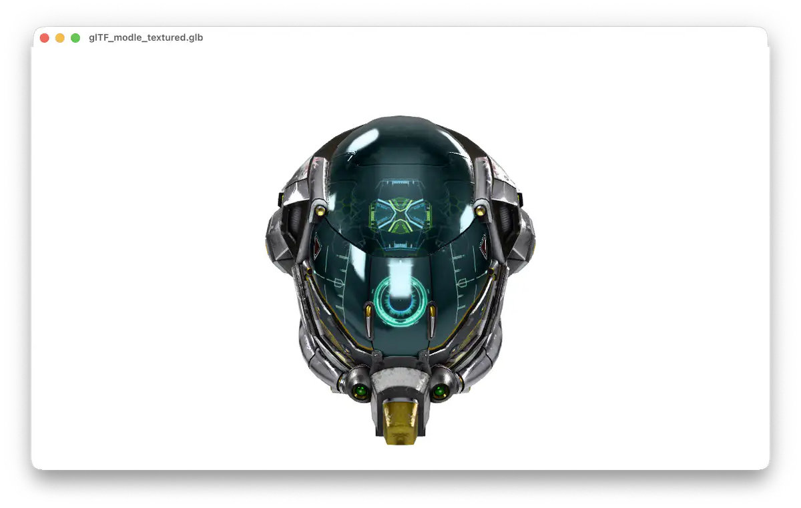
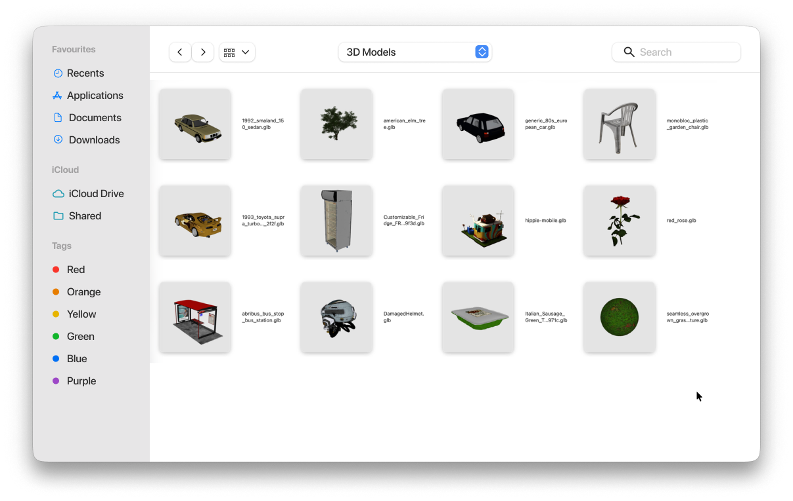
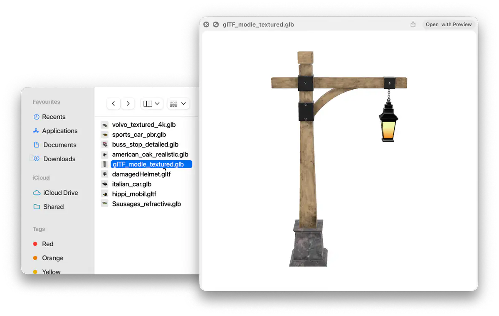
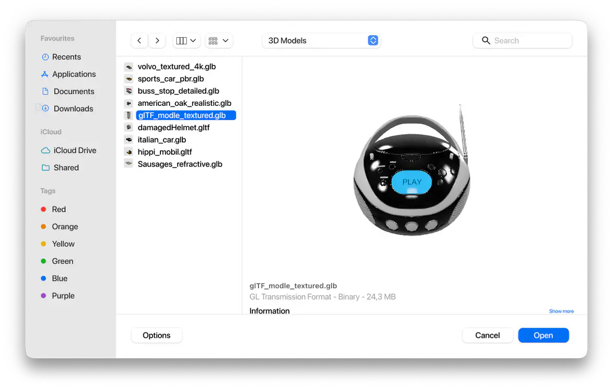
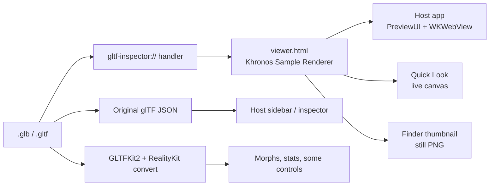

<p align="center">
  
</p>

<h1 align="center">macOS glTF Inspector</h1>

<p align="center">
  <strong>Native App and Finder Support for <code>.glb</code> and <code>.gltf</code> Using the <a href="https://github.com/KhronosGroup/glTF-Sample-Renderer">Khronos glTF Sample Renderer</a> in WebKit</strong><br>
  Inspector App, Thumbnails, Quick Look and Preview Pane
</p>

<table>
  <tr>
    <td align="center" valign="top" width="50%">
      
      <small>Viewer App</small>
    </td>
    <td align="center" valign="top" width="50%">
      
      <small>Thumbnails</small>
    </td>
  </tr>
  <tr>
    <td align="center" valign="top" width="50%">
      
      <small>Quick Look</small>
    </td>
    <td align="center" valign="top" width="50%">
      
      <small>Preview Pane</small>
    </td>
  </tr>
</table>

This branch (`webkit-renderer`) draws the model with **one WebKit page** on every surface.
RealityKit is not the on-screen renderer. The host app still converts the file to a RealityKit
`Entity` so the sidebar, morphs, and a few controls have a native scene graph.

## Install

1. Download [glTFInspector.zip](https://github.com/Hemmingsson/macos-gltf-inspector/releases/latest).
2. Move `glTF Inspector.app` to `/Applications`.
3. Control-click → **Open** (or allow under **System Settings → Privacy & Security**).
4. Open the app once so the Quick Look preview and thumbnail extensions load.

Released zips follow **`main`**, which still uses RealityKit. To run this branch, build it.

## Build

Requires macOS 26+ on Apple Silicon, Xcode, and [XcodeGen](https://github.com/yonaskolb/XcodeGen). Set `DEVELOPMENT_TEAM` in `project.yml` to your own Apple Developer team.

1. `brew install xcodegen`
2. `./scripts/build.sh`

This generates the Xcode project, builds, installs to `/Applications`, and checks that the Quick Look extensions registered.

```bash
xcodegen generate
DEVELOPER_DIR=/Applications/Xcode.app/Contents/Developer \
  xcodebuild -scheme GLTFInspector -destination 'platform=macOS' \
  -derivedDataPath /tmp/GLTFInspector-dd test
```

Renderer regressions need the Khronos samples on disk (`./scripts/fetch-test-models.sh`);
missing samples fail the pixel-diff coverage test rather than skip. See
[`TestModels/References/README.md`](TestModels/References/README.md).

## How it works

The file is served into a `WKWebView` over a custom `gltf-inspector://` scheme. The page
(`RendererWebKit/web-renderer/viewer.html`) loads the [Khronos glTF Sample Renderer](https://github.com/KhronosGroup/glTF-Sample-Renderer)
(`GltfView` / `GltfState`). Swift talks to the page through `__viewer.exec` and
`webkit.messageHandlers.viewer` — see `RendererWebKit/`.

Finder thumbnail, Quick Look, and the document window use **that same page**. A second HTML
file would let the surfaces drift. Thumbnails run the page off-screen (`.still`) and take
`canvas.toDataURL()`; the window and Quick Look run it live.



The host window is **`PreviewUI`** chrome over one renderer's canvas. **Settings ▸ Preview ▸ Renderer**
(`settings.preview.renderer`) picks RealityKit (default) or WebKit for new
windows, Quick Look and Finder thumbnails. On WebKit the page loads the file itself and the panels
come from the JSON alone — no convert runs; on RealityKit one convert feeds canvas and chrome.
Either way the outliner describes the **file** (`GLTFDocumentJSON` from original JSON), not the
subset that survived convert.

Look defaults (environment + tone map) are shared: extensions read the app's preferences
plist, because a sandboxed `UserDefaults` suite is invisible. Thumbnail and preview
extensions need `com.apple.security.network.client` so WebKit's Networking XPC can start —
the page itself does not fetch from the network.

Why WebKit instead of RealityKit: [`docs/decision-web-renderer.md`](docs/decision-web-renderer.md).
Pixel path: [`docs/pipeline-web-renderer.md`](docs/pipeline-web-renderer.md). Convert /
inspector path: [`docs/pipeline-gltf-to-realitykit.md`](docs/pipeline-gltf-to-realitykit.md).

## License

Released under the [MIT License](LICENSE). Bundled dependencies — [GLTFKit2](https://github.com/warrenm/GLTFKit2), [DracoSwift](https://github.com/warrenm/DracoSwift), and [Sparkle](https://github.com/sparkle-project/Sparkle) — are MIT-licensed. The vendored [Khronos glTF Sample Renderer](Vendor/web-renderer) is Apache-2.0. The [Khronos glTF-Validator](Vendor/gltf-validator) and IBL environments carry their own licenses in-tree.
