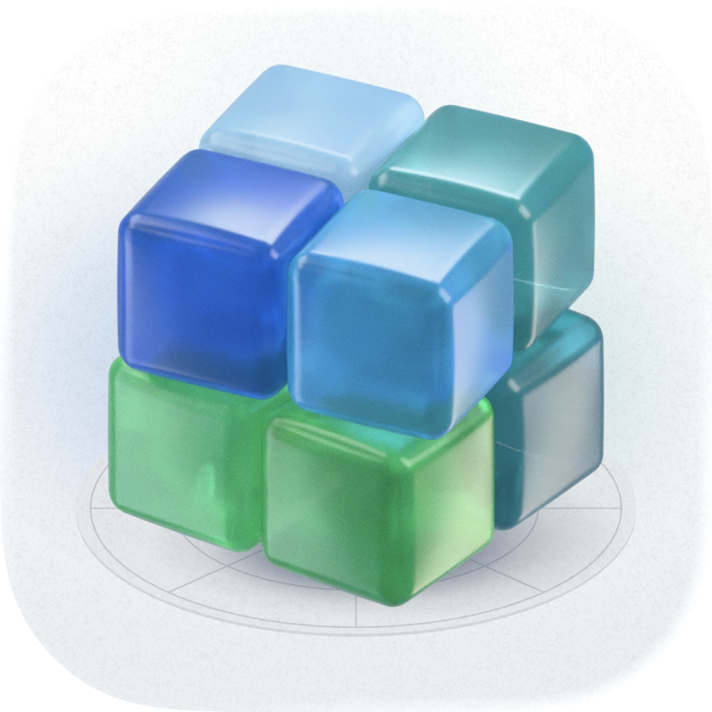
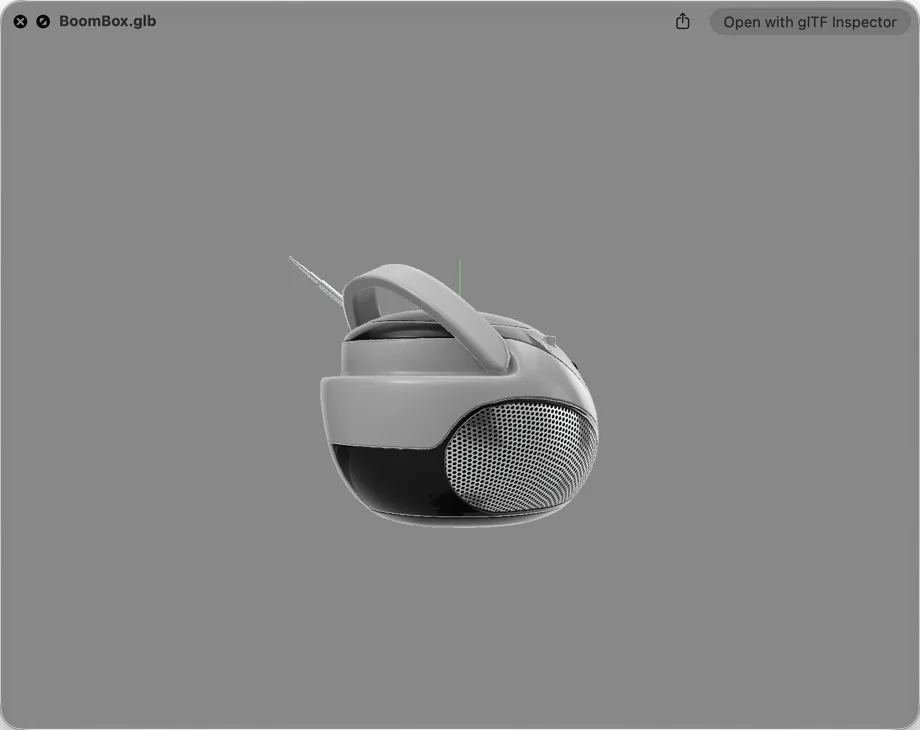
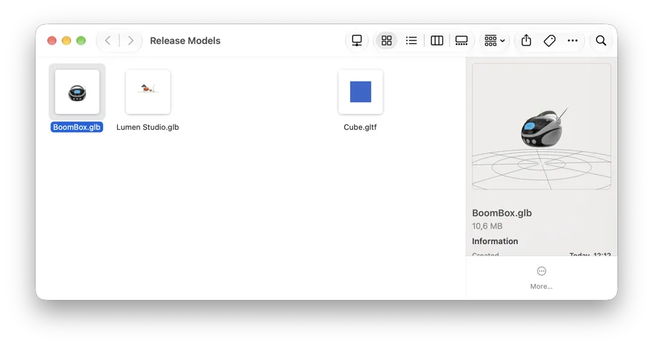

<div align="center">



# glTF Inspector

Open and inspect `.glb` and `.gltf` models on your Mac.
Preview them in Finder with Quick Look and thumbnails.

</div>

<p align="center">
  <br>
  <small>Viewer App</small>
</p>

<table>
  <tr>
    <td align="center" valign="top" width="33%">
      <br>
      <small>Thumbnails</small>
    </td>
    <td align="center" valign="top" width="33%">
      <br>
      <small>Quick Look</small>
    </td>
    <td align="center" valign="top" width="33%">
      <br>
      <small>Preview Pane</small>
    </td>
  </tr>
</table>

## Install

Requires macOS 26 or newer on Apple Silicon.

Downloadable builds are not available yet. [Build from source](docs/development.md).

## Use

Open a model in the app, or select it in Finder and press **Space** for Quick Look.
For `.gltf`, keep the referenced buffers and textures with the model.

- Drag to orbit, **Shift-drag** to pan, and scroll to zoom.
- Select an item in the sidebar to inspect its mesh, materials, or other properties.
- Change the lighting and view mode, or play an animation from the timeline.
- Export an image as PNG, or a turntable as MP4 or GIF.

[Controls and shortcuts](docs/usage.md).

## Development

[Set up signing](docs/development.md) first, then:

```sh
brew install xcodegen
./scripts/dev.sh build
```

See [setup and tests](docs/development.md), [architecture](docs/architecture.md), and [design](docs/design.md).

## License

[MIT](LICENSE). [Dependencies](GLTFInspector/Resources/ThirdPartyLicenses) and
[lighting images](Renderer/Environments/LICENSES.md) have their own licenses.

The app hero is a real window capture. The three existing feature demos are
`assets/finder_thumbnails.png`, `assets/finder_details_pane.webp`, and `assets/quick_look.webp`.
[Capture details](demo/README.md).
