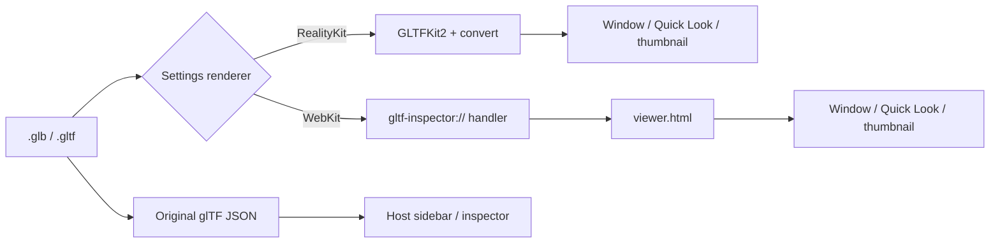

<p align="center">
  
</p>

<h1 align="center">macOS glTF Inspector</h1>

<p align="center">
  <strong>Native App and Finder Support for <code>.glb</code> and <code>.gltf</code></strong><br>
  Inspector App, Thumbnails, Quick Look and Preview Pane — RealityKit by default, or the <a href="https://github.com/KhronosGroup/glTF-Sample-Renderer">Khronos glTF Sample Renderer</a> in WebKit
</p>

<table>
  <tr>
    <td align="center" valign="top" width="50%">
      
      <small>Viewer App</small>
    </td>
    <td align="center" valign="top" width="50%">
      
      <small>Thumbnails</small>
    </td>
  </tr>
  <tr>
    <td align="center" valign="top" width="50%">
      
      <small>Quick Look</small>
    </td>
    <td align="center" valign="top" width="50%">
      
      <small>Preview Pane</small>
    </td>
  </tr>
</table>

The same renderer draws the model on every surface. **Settings ▸ Preview ▸ Renderer** picks
RealityKit (default, what `main` ships) or WebKit. On WebKit the page loads the file itself
and the panels come from the JSON alone — no convert. On RealityKit one convert feeds canvas
and chrome.

## Install

1. Download [glTFInspector.zip](https://github.com/Hemmingsson/macos-gltf-inspector/releases/latest).
2. Move `glTF Inspector.app` to `/Applications`.
3. Control-click → **Open** (or allow under **System Settings → Privacy & Security**).
4. Open the app once so the Quick Look preview and thumbnail extensions load.

Released zips follow **`main`**, which still uses RealityKit. To run this branch, build it.

## Build

Requires macOS 26+ on Apple Silicon, Xcode, and [XcodeGen](https://github.com/yonaskolb/XcodeGen). Set `DEVELOPMENT_TEAM` in `project.yml` to your own Apple Developer team.

1. `brew install xcodegen`
2. `./scripts/build.sh`

This generates the Xcode project, builds, installs to `/Applications`, and checks that the Quick Look extensions registered.

```bash
./scripts/dev.sh test
```

Renderer regressions need the Khronos samples on disk (`./scripts/fetch-test-models.sh`);
missing samples fail the pixel-diff coverage test rather than skip. See
[`TestModels/References/README.md`](TestModels/References/README.md).

## How it works

The host window is **`PreviewUI`** chrome over one renderer's canvas. **Settings ▸ Preview ▸ Renderer**
(`settings.preview.renderer` in the App Group suite) picks RealityKit (default) or WebKit for
new windows, Quick Look and Finder thumbnails.

On **WebKit** the file is served into a `WKWebView` over `gltf-inspector://`. The page
(`RendererWebKit/web-renderer/viewer.html`) loads the [Khronos glTF Sample Renderer](https://github.com/KhronosGroup/glTF-Sample-Renderer).
The page loads the file itself; panels come from the JSON (`GLTFDocumentSummary`) — no convert.
Thumbnails run the page off-screen (`.still`) and take `canvas.toDataURL()`. Do not add a
second HTML file.

On **RealityKit** one convert (`EntityLoader` → GLTFKit2) feeds the canvas and the
RealityKit-only chrome.



Either way the outliner describes the **file** (`GLTFDocumentJSON` from original JSON), not the
subset that survived convert.

Look defaults (environment + tone map) are shared through the App Group suite
(`AppGroupSettings`). Never `UserDefaults.standard` or the host's preferences domain — a
sandboxed extension has its own container. Thumbnail and preview extensions need
`com.apple.security.network.client` so WebKit's Networking XPC can start — the page itself
does not fetch from the network.

Why WebKit instead of RealityKit: [`docs/decision-web-renderer.md`](docs/decision-web-renderer.md).
Pixel path: [`docs/pipeline-web-renderer.md`](docs/pipeline-web-renderer.md). Convert /
inspector path: [`docs/pipeline-gltf-to-realitykit.md`](docs/pipeline-gltf-to-realitykit.md).

## License

Released under the [MIT License](LICENSE). Bundled dependencies — [GLTFKit2](https://github.com/warrenm/GLTFKit2), [DracoSwift](https://github.com/warrenm/DracoSwift), and [Sparkle](https://github.com/sparkle-project/Sparkle) — are MIT-licensed. The vendored [Khronos glTF Sample Renderer](RendererWebKit/web-renderer) is Apache-2.0. The [Khronos glTF-Validator](Vendor/gltf-validator) and IBL environments carry their own licenses in-tree.
