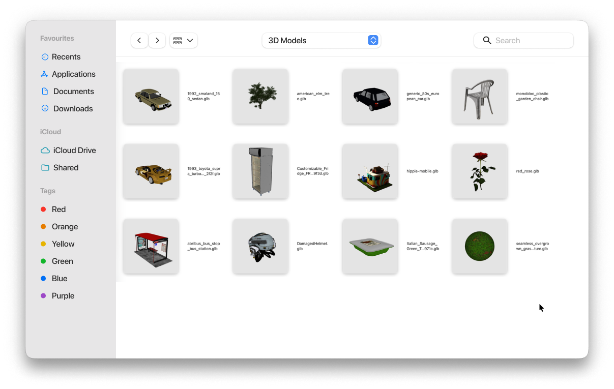
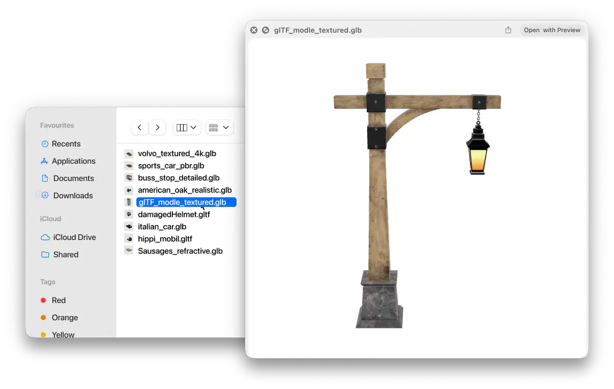
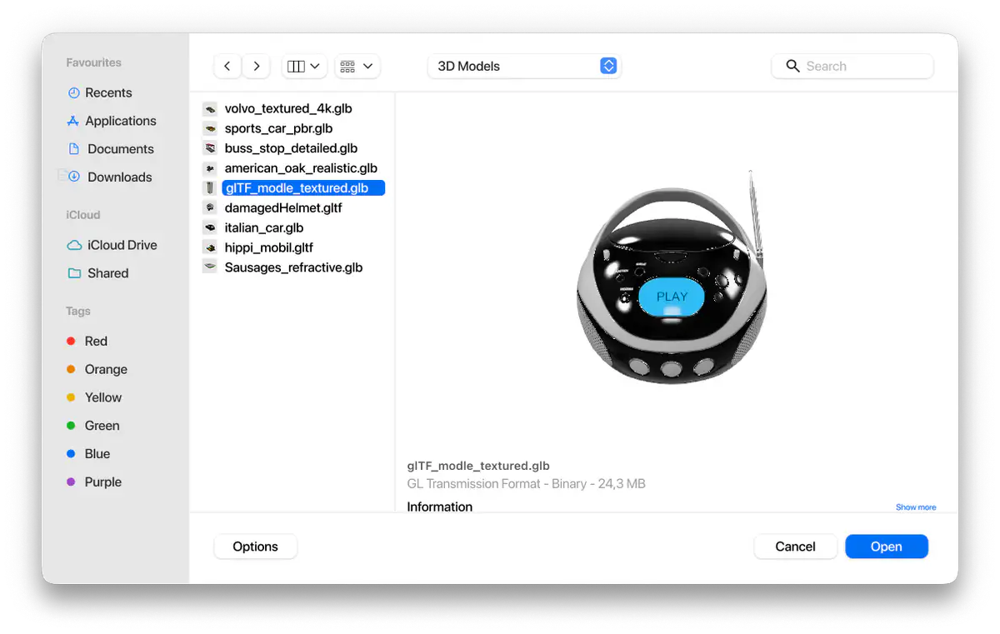
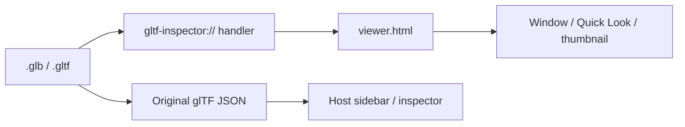

<p align="center">
  
</p>

<h1 align="center">macOS glTF Inspector</h1>

<p align="center">
  <strong>Native App and Finder Support for <code>.glb</code> and <code>.gltf</code></strong><br>
  Inspector App, Thumbnails, Quick Look and Preview Pane — rendered by the <a href="https://github.com/KhronosGroup/glTF-Sample-Renderer">Khronos glTF Sample Renderer</a>
</p>

<table>
  <tr>
    <td align="center" valign="top" width="50%">
      
      <small>Viewer App</small>
    </td>
    <td align="center" valign="top" width="50%">
      
      <small>Thumbnails</small>
    </td>
  </tr>
  <tr>
    <td align="center" valign="top" width="50%">
      
      <small>Quick Look</small>
    </td>
    <td align="center" valign="top" width="50%">
      
      <small>Preview Pane</small>
    </td>
  </tr>
</table>

The same page draws the model in the app, in Quick Look and in Finder. There is no renderer
setting. Lighting, cameras and view mode change the picture; the page does not move the model's
geometry, and it draws the rest pose.

## Install

1. Download [glTFInspector.zip](https://github.com/Hemmingsson/macos-gltf-inspector/releases/latest).
2. Move `glTF Inspector.app` to `/Applications`.
3. Control-click → **Open** (or allow under **System Settings → Privacy & Security**).
4. Open the app once so the Quick Look preview and thumbnail extensions load.

## Build

Requires macOS 26+ on Apple Silicon, Xcode, and [XcodeGen](https://github.com/yonaskolb/XcodeGen). Set `DEVELOPMENT_TEAM` in `project.yml` to your own Apple Developer team.

1. `brew install xcodegen`
2. `./scripts/build.sh`

This generates the Xcode project, builds, installs to `/Applications`, and checks that the Quick Look extensions registered.

```bash
./scripts/dev.sh test
```

Renderer regressions need the Khronos samples on disk (`./scripts/fetch-test-models.sh`);
missing samples fail the pixel-diff coverage test rather than skip. See
[`TestModels/References/README.md`](TestModels/References/README.md).

## How it works

The host window is **`PreviewUI`** chrome over one canvas. The canvas is drawn by a native
Metal port of the [Khronos glTF Sample Renderer](https://github.com/KhronosGroup/glTF-Sample-Renderer)
(`RendererMetal/`), which loads the file itself. The window, Quick Look and the Preview Pane run
it live; thumbnails render one frame off-screen. The original Khronos page in a `WKWebView`
(described below and in the pipeline doc) remains as a dev override and as the reference the
Metal port is pixel-tested against; see
[`docs/renderer-backends.md`](docs/renderer-backends.md).

The WebKit page path: the file is served into a `WKWebView` over `gltf-inspector://`; the page
(`RendererWebKit/web-renderer/viewer.html`) runs the Khronos renderer and loads the file
itself. Thumbnails take `canvas.toDataURL()`.



The outliner and inspector describe the **file** (`GLTFDocumentSummary` from the original
JSON), not what a renderer kept.

Look defaults (environment + tone map) are shared through the App Group suite
(`AppGroupSettings`) — a sandboxed extension cannot read the host's preferences domain.
Thumbnail and preview extensions keep `com.apple.security.network.client` so WebKit's
Networking XPC can start under the WebKit override; nothing fetches from the network.

Details: [`docs/pipeline-web-renderer.md`](docs/pipeline-web-renderer.md).

## License

Released under the [MIT License](LICENSE). [Sparkle](https://github.com/sparkle-project/Sparkle) is MIT-licensed. The vendored [Khronos glTF Sample Renderer](RendererWebKit/web-renderer) is Apache-2.0. The [Khronos glTF-Validator](Vendor/gltf-validator) and IBL environments carry their own licenses in-tree.
