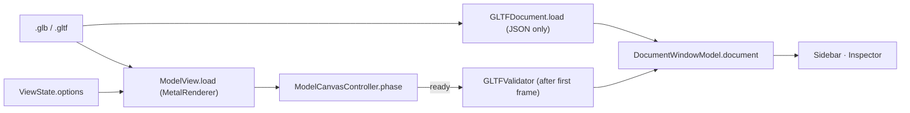

# Architecture

glTF Inspector draws a `.glb` / `.gltf` file with a Metal port of the Khronos glTF Sample Renderer
and shows what the file contains next to it. The same renderer draws the document window, the
Quick Look preview and the Finder thumbnail.

## Modules

| Target | Owns | Linked by |
| --- | --- | --- |
| `GLTFCore` (framework) | What a file contains: `GLTFDocument` parsed from the JSON (`GLTFDocumentJSON`), the glTF-Validator (`GLTFValidator`, the Khronos validator in a `JSContext`), the look vocabulary (`RenderLook`, `RenderViewMode`, `KhronosEnvironments`) and the App Group settings (`AppGroupSettings`). | everything |
| `Renderer` (framework) | Drawing: `MetalRenderer` (the Khronos port: scene loading via GLTFKit2, shaders, lighting bakes), `ModelView` (the `NSView` that owns a renderer and the Khronos orbit camera), `ModelCanvas` + `ModelCanvasController` (the SwiftUI canvas: loading / ready / failed), `ThumbnailRenderer`. | app, both extensions |
| `GLTFInspector` (app) | The window: `DocumentWindowModel` (which file, its `GLTFDocument`, validation) and `ViewState` (how this window shows it), the sidebar, inspector, toolbar, menus and Settings. `DesignSystem/` holds the shared tokens and glass controls. | — |
| `PreviewExtension` | Quick Look: one `ModelCanvas` with the stored look. | — |
| `ThumbnailExtension` | Finder thumbnails: `ThumbnailRenderer` → a PNG file for `QLThumbnailReply`. | — |

Both frameworks are extension-safe. They are embedded once, in the app's `Contents/Frameworks`;
the extensions find them (and the GLTFKit2 package framework) through their
`@executable_path/../../../../Frameworks` rpath.

## Opening a file in a window

1. `DocumentWindow` calls `DocumentWindowModel.beginOpen` (logs `open start`) and starts
   `openSummary`, which reads the JSON into a `GLTFDocument` off the main thread
   (`open ready` / `open failed`). The panels follow `DocumentWindowModel.phase`.
2. In parallel the canvas mounts: `ModelCanvasController` loads the file into its `ModelView`
   and applies `ViewState.options` (`canvas ready` / `canvas failed`). The canvas region follows
   the controller's phase, so a model can draw while the panels are still loading, and a panel
   failure never hides a drawn model.
3. When the canvas is ready, validation runs once (it is CPU heavy) and its findings are
   resolved to outliner rows (`ValidationResult`).

Every user action edits `ViewState` (toolbar, menu bar and sidebar all bind to it). SwiftUI
re-renders, `ModelCanvas` hands the new `ViewOptions` to the controller, and the controller
applies them to the `ModelView` one call at a time, so the latest options always win. Camera
commands (fit, presets, zoom) and Export PNG go from `ViewState` to the controller directly.
A failed load ends in `.failed(message)`, never a spinner.

## Quick Look and thumbnails

Quick Look mounts one `ModelCanvas` with `ViewOptions.stored(showsFloor: true)`: the environment
and tone mapping Settings stored in the App Group. The thumbnail extension renders through one
`ThumbnailRenderer` per process (requests serialized, so a folder does not hold a renderer per
file) with the same stored look, writes a PNG to its temporary directory and replies with
`QLThumbnailReply(imageFileURL:)`.

Settings live only in the App Group suite (`AppGroupSettings.defaults`). The sandboxed
extensions can read it, and only the app writes it.

## Accuracy and speed

`TestModels/References/` holds images rendered by the Khronos Sample Renderer itself: one per
pinned Khronos sample (`manifest.json`), and `Features/` for overlays, view modes, file cameras,
scenes and the lighting options. `./scripts/dev.sh test` renders all of them with the Metal
renderer and compares them (`PixelDiffMetalTests`); see
[`TestModels/References/README.md`](../TestModels/References/README.md).

`./scripts/dev.sh bench` prints load, first-still and GPU frame times for three samples.

## Debugging

- `./scripts/dev.sh run <fixture>` installs into `.build/` and opens a fixture with file
  logging; `./scripts/dev.sh logs` tails `.build/logs/debug.log`. Without the file, use
  `log stream --predicate 'subsystem == "lol.mattias.gltf-inspector"'` (categories `app`,
  `renderer`, `thumbnail`, `settings`).
- A window logs exactly one `open start`, then `open ready` or `open failed`, then
  `canvas ready` or `canvas failed`, then a `validation` line.
- Pixel-diff failures write `-actual`, `-expected` and `-diff` PNGs to
  `/tmp/GLTFInspector-pixel-diff/`.
