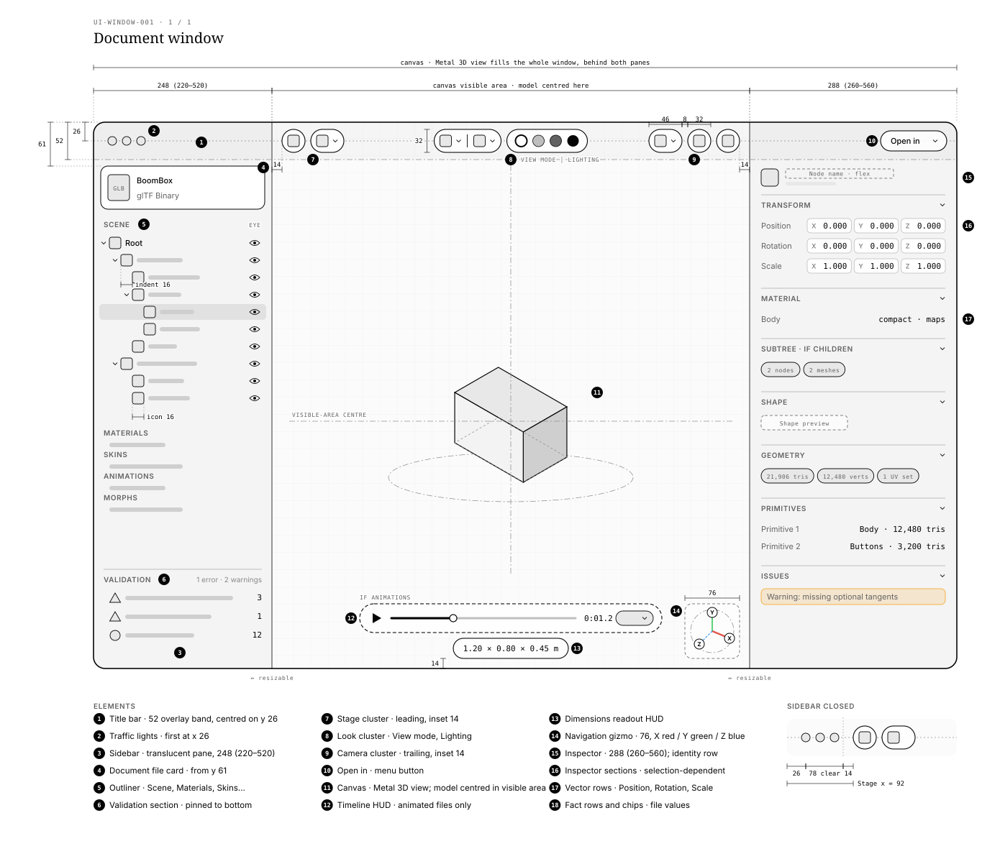

# Design

Keep the model in focus. Use quiet native controls. Check the code when this guide and the app differ.

These rules do not certify feature coverage. See [limits](usage.md#limits).

This file defines product, layout, component, and copy rules.

## Product rules

- Use native glass, fonts, appearance, and accessibility settings. Put every command in the menu bar with its shortcut. In-window controls use the same actions.
- Use compact controls, small type, and hairlines. Omit text that does not help the user.
- Settings define new-window defaults. `ViewState` defines this window. Give each control one owner. Window controls do not rewrite Settings.
- Show controls only for data in the file. Hide controls that do not apply.
- Panels describe source JSON, not the renderer's retained data. Validation checks the file, not render coverage. File dimensions and statistics are derived values, not independent measurements.
- Use Khronos Sample Viewer output as the reference on all surfaces. This is a design target, not a conformance claim.
- Keep opening responsive. Load lighting bakes during frame setup and cache them. Center and fit in the app by default; expose centering as view state.
- Use accent for selection and active state. Use role tints for glTF types.
- Never write the source file. Hide/solo, picking, gizmos, skeleton overlays, and animation are window state. Quick Look and thumbnails keep the rest pose with nothing hidden.
- Do not add a renderer selector, duplicate settings, or controls the renderer cannot drive: morph sliders, double-sided overrides, or custom environments.

Use tokens from [`DS.swift`](../GLTFInspector/DesignSystem/DS.swift) and existing
[`DS` components](../GLTFInspector/DesignSystem/Components). These are authoring rules;
check the implementation when a view differs.

## Window anatomy



| Part | Size (pt) | Token |
| --- | --- | --- |
| Sidebar (outliner, validation) | 248, resizable 220–520 | `Metrics.sidebarWidth`, `sidebarWidthRange` |
| Inspector | 288, resizable 260–560 | `Metrics.inspectorWidth`, `inspectorWidthRange` |
| Toolbar band (shared with the traffic lights) | 52 high, centre line y 26 | `Metrics.toolbarBandHeight`, `toolbarCenterY` |
| Canvas clusters (Stage, Look, Camera) | inset 14 from the canvas edge | `Metrics.canvasClusterInset` |
| Traffic-light clearance, sidebar closed | 78 | `Metrics.trafficLightLeadingClearance` |
| Navigation gizmo | 76 | `Metrics.navigationGizmoSize` |

- The canvas fills the whole window behind the panes, and the model centres in the part the panes
  leave visible.
- Pane content sits 8 from the pane edge (`Spacing.paneInset`).
- Full screen keeps the windowed layout. The toolbar slides in on hover.
- One window per document. Tabbing is off.

## Colour

Use system semantics. A hex value in a view is a bug; a new colour needs a role in `DS.Color`.

| Use | Value |
| --- | --- |
| Text | `.primary`, `.secondary`, `.tertiary` |
| Lines | `DS.Color.separator`, 1 pt (`Metrics.hairline`). Increase Contrast strengthens it. |
| Pane background | `DS.Color.paneFill`: white 82 % (light), 12 % white at 82 % (dark), over the canvas |
| Selection, "on" state | System accent. Nothing else uses it. |
| Pre-selection (canvas hover on a row) | `DS.Color.pointedRowFill`, accent at 14 % |

`DS.Color.Role` tints identify glTF types. They do not follow the user's accent:

| Role | Light | Dark |
| --- | --- | --- |
| Mesh, and structure (scene, skin, morph, empty) | `#6E6E73` graphite | `#A0A0A6` |
| Camera | `#0A84FF` | `#4CA8FF` |
| Light | `#F5A623` | `#FFC04D` |
| Material | `#A06BD6` | `#C29BEC` |
| Animation | `#34C759` | `#30D158` |

`DSStatus`: valid green, warning orange, error red; pending and note secondary.
Each status also has a distinct shape. Reserve red for errors.

**Axes** (`DS.Color.Axis`): X `#E2564A`, Y `#34C759`, Z `#0A84FF`. Negative ends are secondary.

**Canvas and backdrop** (`DS.Color.Canvas`, `DS.Color.Backdrop`) paint the stage, not chrome.

## Type

SwiftUI text styles only, never a point size. On macOS they are body 13, callout 12, subheadline 11,
caption 10.

| Text | Style |
| --- | --- |
| Outliner row title | `.subheadline` |
| Section header (SCENE, MATERIALS) | `.subheadline` semibold, uppercase, tracking 0.5: `dsSectionHeader()` |
| Fact label | `.callout`, `.secondary` |
| Fact value, transform cell | `.callout.monospacedDigit()`, selectable |
| Chip | `.subheadline.monospacedDigit()` |
| Row badge (child count) | `.caption2` semibold |
| Slider title | `.body` |

- **Every number** uses monospaced digits.
- **Names** of nodes, meshes and materials appear exactly as the file spells them.
- **Weight** carries hierarchy. Size changes stay inside the four styles above.

## Spacing and size

A 4 pt scale (`DS.Spacing`):

| xxs | xs | s | m | l | xl | xxl |
| --- | --- | --- | --- | --- | --- | --- |
| 2 | 4 | 6 | 8 | 12 | 16 | 24 |

- **No literals.** `spacing: 0` is fine; any other number in a view is a missing token.
- **Pane controls are dense.** Use `.controlSize(.small)` for pickers, toggles and buttons in the
  sidebar, inspector and popovers. Glass controls on the canvas keep their 32 pt size.
- **Glass control**: 32 square, or 46 wide with a menu chevron (`Metrics.glassControl`,
  `glassControlWide`).
- **Rows and icons**: type icon 16, scaled with text size via `@ScaledMetric`
  (`Metrics.typeIcon`). Outline indent 16.
- **Swatch** 20 with a 1.5 ring and a 2 gap.
- **Popover**: 240 min, 260 ideal width, height fits its content.

## Shape

- Corners are always `.continuous` (`DS.Radius`):

| Radius | Value | For |
| --- | --- | --- |
| small | 6 | chips, swatch wells, value cells |
| medium | 8 | cards, issue rows |
| large | 12 | grouped blocks |
| pane | 18 | panes |

- Glass is always a capsule.
- Separate things with hairlines and space, not boxes or shadows.

## Liquid Glass

Glass is for things that float over the model: the canvas clusters and HUDs. Nothing else.

- **One container per cluster.** `DSGlassCluster` wraps one `GlassEffectContainer` with 8 spacing,
  so its islands sample the backdrop together.
- An island owns its glass layer. Its controls are borderless (`DSGlassPlacement.inIsland`).
- **Control glass** is `.regular.interactive()`. **Engaged** adds a 18 % accent wash, and the glyph
  carries the full tint. **HUD glass** is `.regular` and not interactive.
- **Never glass on glass.** Popovers add no background. Panes use `paneFill`, not glass.

## Components

Style controls through `DS` components. Add a component when one is missing, even for a stock control.

**Glass (canvas)**

| Component | For | Not for |
| --- | --- | --- |
| `DSGlassCluster` | one floating group (Stage, Look, Camera) | anything in a pane |
| `DSGlassIsland` + `DSGlassIslandDivider` | several related controls in one capsule | a single control |
| `DSGlassToggleButton` | icon-only on/off (Floor, ortho) | actions without state |
| `DSGlassMenuButton` | a control that opens a menu (camera presets, view mode) | |
| `DSGlassPopoverButton` | icon + chevron that owns a popover (Lighting, FOV) | |
| `DSSwatchPicker` | radio group of colour swatches (backdrop) | |
| `DSHUDCapsule` | a read-only readout (dimensions) | controls |
| `DSTimeline` | animation transport at the canvas bottom | |

**Controls (panes and popovers)**

| Component | For |
| --- | --- |
| `DSPicker` | a system picker with title leading, control trailing |
| `DSSlider` | a titled continuous value with its reading |
| `DSPopoverPanel` | the content column of a control popover; no background |

**Content (read-only)**

| Component | For |
| --- | --- |
| `DSSectionHeader` | the uppercase label over a section |
| `DSOutlineRow` | one outliner row: indent, type glyph, title, visibility |
| `DSIcon` | any glyph in chrome: Inspector icon, SF Symbol fallback |
| `DSTypeIcon` | the glTF type glyph in its 16 pt square |
| `DSFactRow` | "label · value" (Triangles 12) |
| `DSFactorRow` | a bounded scalar as a bar (Roughness 0.650) |
| `DSValueCell`, `DSVectorRow` | transform values, one row per P/R/S |
| `DSChip` + `DSFlowLayout` | compact tags that wrap ("12 tris", "Normal") |
| `DSStatus`, `DSStatusBadge`, `DSDisclosureCard` | validation outcome: one vocabulary everywhere |
| `DSDocumentCard` | the file card at the top of the sidebar |

Values are read-only. The app does not write the file.

## Icons

Browse the [icon set](../assets/icons/inspector/README.md) and its [drawing guide](../assets/icons/inspector/STYLEGUIDE.md).

Use `DSGlyphs` or a model enum's `.glyph`. Call sites name the role, not an image.
Each glyph supplies an Inspector icon and an SF Symbol fallback.

```swift
DSLabel("Zoom In", DSGlyphs.zoomIn)        // a title and its glyph, for menus and buttons
DSIcon(mode.glyph)                         // a bare glyph
DSGlassToggleButton("Floor", systemImage: DSGlyphs.floor.symbol,
                    assetImage: DSGlyphs.floor.assetImage)
```

1. Use the drawn set first: 78 original icons, 24 × 24, 2px stroke, round caps and joins, five shared carriers. Read its `STYLEGUIDE.md` before drawing.
2. Add the SVG, run `node assets/icons/inspector/build-catalog.mjs`, then add its `DSGlyph` in `InspectorIcons.swift`. Reuse a carrier and mark. Channels and texture maps share marks.
3. **glTF types** use `DSTypeIcon`. Materials show their swatch. Shared meshes use `DSGlyphs.sharedMesh`.
4. **Chrome** uses `DSIcon` with the Inspector catalog and a system symbol fallback.

- **Size and colour.** Icons sit in a 16 pt square (`Metrics.typeIcon`, scaled with text) and
  take the surrounding `foregroundStyle`. Role tints apply only to type glyphs. On a selected row
  they follow the selection highlight.

## Copy

- Use glTF words: node, mesh, primitive, material, accessor.
- Buttons are verbs. Never "OK".
- An error names the problem in the file or the fix, never the API.
- No help text in panes. If a control needs explaining, change the control.
- Shortcuts live in the menu bar and in tooltips (`.help`), not in labels.

## Accessibility

- Colour never carries meaning alone: status and role also differ in shape.
- Text follows the user's size setting. Metrics that sit next to text use `@ScaledMetric`.
- A row reads as one element ("Triangles, 12"). Decorative glyphs and dividers are hidden from
  VoiceOver.
- Each canvas cluster is one `.focusSection()`.
- Check light, dark, Increase Contrast and the largest text size.

## Adding UI

1. Get approval for an HTML mockup or wireframe. Fit new UI into the existing layout.
2. **Use or add a `DS` component.** A new value becomes a `DS` token with a comment on what it is for.
3. The old token/component catalog is at `0fe56f15^:DesignCatalog/`; it was removed in `0fe56f15`.
4. **Check it on screen** with `./scripts/dev.sh run <fixture>`, in both appearances.
