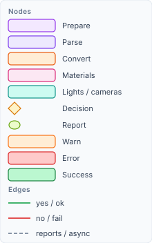
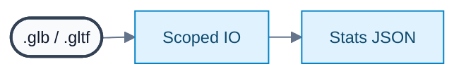
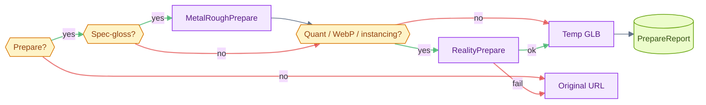
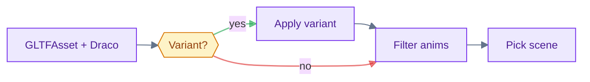
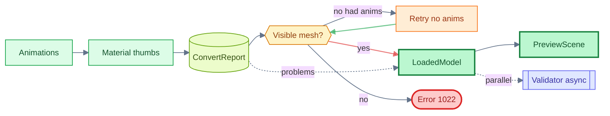

# glTF → RealityKit pipeline (inspector / convert)

How a file becomes a RealityKit `Entity` for **host chrome** — sidebar document extras,
morphs, animations, convert reports, and the unused `PreviewScene` fallback.

**This is not what draws the model** on `webkit-renderer`. Pixels go through WebKit:
[`pipeline-web-renderer.md`](pipeline-web-renderer.md). Entry point here:
`EntityLoader.load(from:)` in `Shared/EntityLoader.swift`. Convert core: `RealityKitConvert`
in `Shared/Convert/`.

---

## Pipeline map

```mermaid
%%{init: {"flowchart": {"htmlLabels": true, "curve": "basis", "padding": 12, "nodeSpacing": 28, "rankSpacing": 48}, "theme": "base", "themeVariables": {"fontSize": "13px", "fontFamily": "system-ui, sans-serif", "primaryColor": "#e0f2fe", "primaryTextColor": "#0c4a6e", "primaryBorderColor": "#0284c7", "lineColor": "#64748b", "secondaryColor": "#f0fdf4", "tertiaryColor": "#fef3c7"}}}%%
flowchart LR
  subgraph S_OPEN["1 Open"]
    direction LR
    U([".glb / .gltf"]):::terminal
    IO[Scoped IO]:::io
    ST[Stats JSON]:::io
    U --> IO --> ST
  end

  subgraph S_PREP["2 Prepare - best-effort"]
    direction LR
    PG{{Prepare?}}:::decision
    MR{{Spec-gloss?}}:::decision
    MRW[MetalRoughPrepare]:::prepare
    RPQ{{Quant / WebP / instancing?}}:::decision
    RPW[RealityPrepare]:::prepare
    PTMP[Temp GLB]:::prepare
    ORG[Original URL]:::prepare
    PrepReport[(PrepareReport)]:::report
    PG -->|no| ORG
    PG -->|yes| MR
    MR -->|yes| MRW --> RPQ
    MR -->|no| RPQ
    RPQ -->|yes| RPW
    RPQ -->|no| PTMP
    RPW -->|ok| PTMP
    RPW -->|fail| ORG
    PTMP --> PrepReport
  end

  subgraph S_PARSE["3 Parse - GLTFKit2"]
    direction LR
    AST[GLTFAsset + Draco]:::parse
    VAR{{Variant?}}:::decision
    VAP[Apply variant]:::parse
    ANF[Filter anims]:::parse
    SC[Pick scene]:::parse
    AST --> VAR
    VAR -->|yes| VAP --> ANF
    VAR -->|no| ANF
    ANF --> SC
  end

  subgraph S_CONV["4 Convert - MainActor"]
    direction LR
    DOC[makeDocument]:::convert
    EM{{Baked emissive?}}:::decision
    SKP[Skip emissive boost]:::convert
    NOD[[Each node loop]]:::convertLoop

    SK{{Skin?}}:::decision
    SKB[Skeleton]:::mesh
    MH{{Mesh?}}:::decision
    SD{{Skinned?}}:::decision
    TF{{Float3 fast path?}}:::decision
    LL[LowLevelMesh]:::mesh
    PRIM[Primitive loop]:::mesh
    PT{{Primitive ok?}}:::decision
    DROP[droppedPrimitive]:::warn
    PART[Mesh part]:::mesh

    MAT{{Material}}:::decision
    CA{{Cached?}}:::decision
    UN{{Unlit?}}:::decision
    UMat[UnlitMaterial]:::material
    PBR[PBR + maps]:::material
    TR{{Transmission?}}:::decision
    TFX[Opacity approx]:::warn
    BL{{Alpha mode}}:::decision
    TX{{Texture loads?}}:::decision
    ERR[missingTexture]:::error
    GEN[TextureResource]:::material
    MOK[Material ok]:::material

    LT{{Light?}}:::decision
    LC[Punctual light]:::scene
    CM{{Camera?}}:::decision
    CAM[Camera]:::scene
    CH[Children recurse]:::scene

    DOC --> EM
    EM -->|yes| SKP --> NOD
    EM -->|no| NOD
    NOD --> SK
    SK -->|yes| SKB --> MH
    SK -->|no| MH
    MH -->|yes| SD
    SD -->|no| TF
    TF -->|yes| LL --> PRIM
    TF -->|no| PRIM
    SD -->|yes| PRIM
    PRIM --> PT
    PT -->|no| DROP --> LT
    PT -->|yes| PART --> MAT
    MAT --> CA
    CA -->|yes| MOK
    CA -->|no| UN
    UN -->|yes| UMat --> BL
    UN -->|no| PBR --> TR
    TR -->|yes| TFX --> BL
    TR -->|no| BL
    BL --> TX
    TX -->|fail| ERR --> MOK
    TX -->|ok| GEN --> MOK
    MOK --> LT
    MH -->|no| LT
    LT -->|yes| LC --> CM
    LT -->|no| CM
    CM -->|yes| CAM --> CH
    CM -->|no| CH
  end

  subgraph S_FINISH["5 Finish - render"]
    direction LR
    AN[Animations]:::finish
    TH[Material thumbs]:::finish
    ConvReport[(ConvertReport)]:::report
    RT{{Visible mesh?}}:::decision
    RY[Retry no anims]:::warn
    LM[LoadedModel]:::success
    FAIL(["Error 1022"]):::error
    PS[PreviewScene]:::success
    VAL[[Validator async]]:::async

    AN --> TH --> ConvReport --> RT
    RT -->|no had anims| RY --> RT
    RT -->|yes| LM
    RT -->|no| FAIL
    LM --> PS
  end

  ST --> PG
  ORG --> AST
  PTMP --> AST
  SC --> DOC
  CH --> AN

  PrepReport -.->|flags| LM
  ConvReport -.->|problems| LM
  LM -.->|parallel| VAL

  classDef terminal fill:#f8fafc,stroke:#334155,stroke-width:2px,color:#0f172a
  classDef io fill:#e0f2fe,stroke:#0284c7,color:#0c4a6e
  classDef prepare fill:#f3e8ff,stroke:#9333ea,color:#581c87
  classDef parse fill:#ede9fe,stroke:#7c3aed,color:#4c1d95
  classDef convert fill:#ffedd5,stroke:#ea580c,color:#9a3412
  classDef convertLoop fill:#fff7ed,stroke:#f97316,stroke-width:2px,color:#9a3412
  classDef mesh fill:#fef9c3,stroke:#ca8a04,color:#713f12
  classDef material fill:#fce7f3,stroke:#db2777,color:#831843
  classDef scene fill:#ccfbf1,stroke:#0d9488,color:#134e4a
  classDef finish fill:#dcfce7,stroke:#16a34a,color:#14532d
  classDef decision fill:#fef3c7,stroke:#d97706,color:#92400e
  classDef report fill:#ecfccb,stroke:#65a30d,color:#365314
  classDef success fill:#bbf7d0,stroke:#15803d,stroke-width:2px,color:#14532d
  classDef warn fill:#ffedd5,stroke:#f97316,color:#9a3412
  classDef error fill:#fecaca,stroke:#dc2626,stroke-width:2px,color:#991b1b
  classDef async fill:#e0e7ff,stroke:#6366f1,color:#3730a3

  linkStyle 3,4,7,9,13,18,22,25,27,30,34,37,39,43,49,53,56,64 stroke:#16a34a99,stroke-width:1.5px
  linkStyle 2,6,8,10,15,20,24,26,29,32,38,41,45,47,52,55,58,62,65 stroke:#dc262699,stroke-width:1.5px
```

Phase detail in sections **1–5** below.

`Each node loop` runs per scene node; `Retry no anims` fires once when convert produced no mesh.

**Retry layers (not all on chart):** prepare best-effort → if prepared temp GLB converts to zero mesh, retry **original URL** → if convert had anims and zero `ModelComponent`s, retry once with `asset.animations = []`.

---

## 1 Open

### Open & IO

Security-scoped access to **both** the file and its parent directory (sidecar `.gltf` needs sibling
buffers/textures). Sidecar URIs are validated (`isAllowedSidecarURI`) — unsafe paths throw **1021**.

`GLTFAsset.dracoDecompressorClassName = "GLBDracoDecompressor"` is set once at the start of
`withPreparedAsset` (before prepare/parse).

### Stats JSON

Lightweight JSON for `PreviewStats` and `PreviewDebugMode`: `GLBBox.peekJSON` (`.glb`) or
`GLBBox.parseJSON` (`.gltf`). When prepare rewrites succeed, **`prepared.sourceJSON`** (post-prepare
JSON) is what stats/debug use — not the raw file header alone. File size is captured separately
(`fileSizeBytes`).

---

## 2 Prepare (best-effort)

If the bytes need rewriting *before* GLTFKit2 can load them, parse to `GLBBox`, transform, serialize,
and write a temp GLB under `/tmp` (`GLBBox.writePrepared`). Temp is deleted in `defer` when load
finishes.

**Gate:** `MetalRoughPrepare.needsConversion(json) || RealityPrepare.needsPrepare(json)` — if neither,
original URL is used unchanged.

**Order (always):** `MetalRoughPrepare` first, then `RealityPrepare`. Each step is best-effort; a
step failure logs and continues with bytes from the previous step.

- **`MetalRoughPrepare`** — `KHR_materials_pbrSpecularGlossiness` → metallic-roughness (+ optional
  texture bake when `images ≤ 40` and textured spec-gloss materials `≤ 24`, max edge 1024).
- **`RealityPrepare`** — dequantize `KHR_mesh_quantization`, WebP → PNG, expand
  `EXT_mesh_gpu_instancing` (skips meshopt-backed instance attrs), name unnamed skin joints, integer
  accessors → float. **`EXT_meshopt_compression` is not stripped** — GLTFKit2 decompresses at parse.
- **Sidecar `.gltf`:** pack to GLB when prepare applies; on prepare **serialize failure**, fall back
  to **packed unprepared temp GLB** (not the original `.gltf` path).
- **`.glb` top-level prepare failure:** fall back to original URL.
- **`seedPipelineReport`** — snapshots `extensionsUsed` and `decompressedDraco` before transforms.
- Flags accumulate in **`PreparePipelineReport`** (`Shared/PreparePipelineReport.swift`).

**Second fallback (convert, not prepare):** if a prepared temp URL converts to zero visible mesh,
`convertPreparedOrOriginal` retries on the **original file URL**.

---

## 3 Parse (GLTFKit2)

### GLTFAsset parse

GLTFKit2 loads the (possibly prepared) URL with `assetDirectoryURL` (prepared sidecar uses temp
directory; unprepared sidecar uses parent folder).

### Material variants (optional)

`MaterialVariants.names(from:)` + optional `MaterialVariants.apply(variantIndex:to:)` on every mesh
primitive **before** convert (`Shared/MaterialVariants.swift`). Variant names are stored on
`LoadedModel.materialVariantNames`. Host passes `materialVariantIndex` into `load` /
`convertScene`.

### Animation filter

When `includeAnimations`: keep clips where `AnimationSampling.hasPositiveDuration` (finite min/max,
`sampleCount > 1`, duration `> 1e-4`) — drops 1-keyframe “Default Take” junk. Thumbnail and
`includeAnimations: false` set `asset.animations = []` (no retry path).

### Scene pick

`sceneIndex` param, else `asset.defaultScene`. Missing / out-of-range → error **1020**.

---

## 4 Convert (MainActor)

```mermaid
%%{init: {"flowchart": {"htmlLabels": true, "curve": "basis", "padding": 10, "nodeSpacing": 18, "rankSpacing": 22}, "theme": "base", "themeVariables": {"fontSize": "11px", "fontFamily": "system-ui, sans-serif", "lineColor": "#64748b"}}}%%
flowchart LR
  DOC[makeDocument]:::convert
  EM{{Baked emissive?}}:::decision
  SKP[Skip emissive boost]:::convert
  NOD[[Each node loop]]:::convertLoop
  SK{{Skin?}}:::decision
  SKB[Skeleton]:::mesh
  MH{{Mesh?}}:::decision
  SD{{Skinned?}}:::decision
  TF{{Float3 fast path?}}:::decision
  LL[LowLevelMesh]:::mesh
  PRIM[Primitive loop]:::mesh
  PT{{Primitive ok?}}:::decision
  DROP[droppedPrimitive]:::warn
  PART[Mesh part]:::mesh
  MAT{{Material}}:::decision
  CA{{Cached?}}:::decision
  UN{{Unlit?}}:::decision
  UMat[UnlitMaterial]:::material
  PBR[PBR + maps]:::material
  TR{{Transmission?}}:::decision
  TFX[Opacity approx]:::warn
  BL{{Alpha mode}}:::decision
  TX{{Texture loads?}}:::decision
  ERR[missingTexture]:::error
  GEN[TextureResource]:::material
  MOK[Material ok]:::material
  LT{{Light?}}:::decision
  LC[Punctual light]:::scene
  CM{{Camera?}}:::decision
  CAM[Camera]:::scene
  CH[Children recurse]:::scene

  DOC --> EM
  EM -->|yes| SKP --> NOD
  EM -->|no| NOD
  NOD --> SK
  SK -->|yes| SKB --> MH
  SK -->|no| MH
  MH -->|yes| SD
  SD -->|no| TF
  TF -->|yes| LL --> PRIM
  TF -->|no| PRIM
  SD -->|yes| PRIM
  PRIM --> PT
  PT -->|no| DROP --> LT
  PT -->|yes| PART --> MAT
  MAT --> CA
  CA -->|yes| MOK
  CA -->|no| UN
  UN -->|yes| UMat --> BL
  UN -->|no| PBR --> TR
  TR -->|yes| TFX --> BL
  TR -->|no| BL
  BL --> TX
  TX -->|fail| ERR --> MOK
  TX -->|ok| GEN --> MOK
  MOK --> LT
  MH -->|no| LT
  LT -->|yes| LC --> CM
  LT -->|no| CM
  CM -->|yes| CAM --> CH
  CM -->|no| CH

  classDef convert fill:#ffedd5,stroke:#ea580c,color:#9a3412
  classDef convertLoop fill:#fff7ed,stroke:#f97316,stroke-width:2px,color:#9a3412
  classDef mesh fill:#fef9c3,stroke:#ca8a04,color:#713f12
  classDef material fill:#fce7f3,stroke:#db2777,color:#831843
  classDef scene fill:#ccfbf1,stroke:#0d9488,color:#134e4a
  classDef decision fill:#fef3c7,stroke:#d97706,color:#92400e
  classDef warn fill:#ffedd5,stroke:#f97316,color:#9a3412
  classDef error fill:#fecaca,stroke:#dc2626,stroke-width:2px,color:#991b1b

  linkStyle 1,5,8,10,13,17,20,22,26,32,36,39 stroke:#16a34a99,stroke-width:1.5px
  linkStyle 3,7,9,12,15,21,24,28,30,35,38,41 stroke:#dc262699,stroke-width:1.5px
```

`RealityKitConvert.convert(scene:asset:document:buildDocument:)` on the picked scene, wrapped in
`GLBTry` (NSException → **1023**). Fails with **1022** when zero `ModelComponent`s after convert.

### makeDocument

When `buildDocument: true`, parallel read model for UI (`GLTFSessionDocument`: nodes, materials,
cameras, lights, skins, morphs, animations). Skipped for thumbnails and `convertScene`.

### Baked emissive gate

If a majority of materials look pre-lit (`PreviewEmissive.fileLooksBaked`), set
`ignoreBakedEmissive` — achromatic emissive boost is dropped on those materials; emissive that
shares the albedo texture is dropped; `emissiveStrength > 1` is kept. Recorded in
`PreparePipelineReport.droppedBakedEmissive` at `loadedModel` time.

### RealityKitResourceContext

Per-convert texture decode cache, material identity cache (`GLTFMaterial` object identity), and
`ConvertProblemReport` accumulation (`lastProblems`).

### Scene graph

Recursive `convert(node:)` on scene root nodes: skin → skeleton → mesh → morph weights → punctual
light → camera → children. **Mesh:** skinned meshes skip the float3 `LowLevelMesh` fast path;
`POINTS` mode becomes tiny cross triangles; dropped primitives → `droppedPrimitive`. **Nil
material** → gray `SimpleMaterial` (no `defaultMaterial` problem is logged today).

### Animations

Each surviving `GLTFAnimation` → `AnimationResource` on the root entity (morph + TRS paths,
densified ≤30 fps). Per-clip failures are logged; they do **not** fail the whole convert.

### stampMaterialPreviews

After convert when `buildDocument: true` and `document.materials.count == asset.materials.count`:
pixel size + 96px PNG thumbs from the convert texture cache. Skipped on thumbnail /
`convertScene` paths.

### Post-convert document backfill

If `buildDocument` and `document.animations` is still empty, fill from `PreviewClip.usable(on:)`.

---

## 5 Finish (render)

### Retry

When `includeAnimations` was true and filtered clips were non-empty: if convert yields **zero**
`ModelComponent`s, retry **once** with `asset.animations = []` (`convertOrRetry`). Thumbnail path
never enters this branch.

### LoadedModel assembly

`loadedModel` (@MainActor) wraps:

| Field | Source |
| --- | --- |
| `entity` | Convert root |
| `stats` | `PreviewStats.from(prepared JSON, animationCount, fileSize, resourceURL)` |
| `document` | `makeDocument` + thumbs + optional animation backfill |
| `debugModes` | `PreviewDebugMode.available(from: json)` |
| `studioIBLExponent` | `PreviewEmissive.studioIBLExponent(punctualLightCount:)` — `0` or `-2` EV |
| `pipelineReport` | Prepare flags + `dimmedStudioIBL` + `droppedBakedEmissive` |
| `convertProblems` | `lastProblems.mergingIgnoredExtensions(from: extensionsUsed)` |
| `materialVariantNames` | From parse (not the applied variant label) |

`mergingIgnoredExtensions` adds warnings for volume, iridescence, anisotropy, dispersion, diffuse
transmission when present in source `extensionsUsed`.

### Render (host / QL)

`PreviewView` → `PreviewScene`: turntable camera, floor, IBL prefetch, session lighting/backdrop,
orbit controls, clip playback. Convert ends at the entity subtree; mount applies look + camera.

### Validation (async)

Khronos validator (`Shared/GLTFValidator.swift`) runs on the host **in parallel** with
`EntityLoader.load` — validates the **original document URL** on disk (not prepared temp bytes).
Soft-skips assets `> 48` MB. Does not gate load success; merged into UI via
`replacingValidation`. Not run for Finder thumbnails.

---

## Honesty outputs (three voices)

| Report | Question | Set in |
| --- | --- | --- |
| `GLTFValidationState` | Is the **file** wrong? | Async validator on **original URL** (host only) |
| `PreparePipelineReport` | What did **prepare** change? | Prepare + `loadedModel` extras |
| `ConvertProblemReport` | What did **convert** drop or approximate? | Convert → `loadedModel` (+ ignored extensions merge) |

`PreparePipelineReport.entries` examples: spec-gloss conversion, dequantization, WebP→PNG, Draco,
dropped baked emissive, file lights on/off vs dimmed studio IBL.

`ConvertProblemReport` codes emitted today: `missingTexture`, `droppedPrimitive`, `missingTexCoord`,
`ignoredExtension`, `approximatedTransmission`, `forcedOpaqueBlend`. (`defaultMaterial` exists in
the enum but is not logged when nil materials get the gray default.)

---

## Key source files

| Area | Files |
| --- | --- |
| Orchestration | `Shared/EntityLoader.swift` |
| Pack / peek JSON | `Shared/GLBBox.swift` |
| Prepare | `Shared/MetalRoughPrepare.swift`, `Shared/RealityPrepare.swift` |
| Variants | `Shared/MaterialVariants.swift` |
| Animation sampling | `Shared/Convert/AnimationHelpers.swift` (`AnimationSampling`) |
| Parse | GLTFKit2 `GLTFAsset` |
| Convert | `Shared/Convert/RealityKitConvert*.swift`, `Shared/Convert/RealityKitResourceContext.swift` |
| Session document | `Shared/GLTFSessionDocument.swift`, `Shared/Convert/RealityKitConvert+Document.swift` |
| Reports | `Shared/PreparePipelineReport.swift`, `Shared/ConvertProblemReport.swift` |
| Validation | `Shared/GLTFValidator.swift` |
| Mount / view | `Shared/PreviewScene.swift`, `Shared/PreviewView.swift`, `Shared/PreviewLighting.swift`, `Shared/PreviewCamera.swift` |
| Thumbnail | `ThumbnailExtension/ThumbnailProvider.swift`, `Shared/StillRenderer.swift` |
| Host wiring | `GLTFInspector/HostShellRootView.swift` |

---

## Thumbnail vs document load

| | `load` | `loadThumbnail` |
| --- | --- | --- |
| `buildDocument` | yes | no |
| Animations | filtered; optional zero-mesh retry | always `[]` |
| Material variant | optional `materialVariantIndex` | never applied |
| Output | `LoadedModel` (8 fields + reports) | `ThumbnailModel` (entity + IBL exponent) |
| Post-process | `PreviewScene` / host chrome | `StillRenderer` → PNG for Finder |
| Validator | host async (parallel) | not run |
| Use | Host window, QL with chrome | Finder thumbnail extension |

---

## Scene re-convert (host)

`EntityLoader.convertScene(index:from:materialVariantIndex:)` re-runs **full prepare + parse** from
disk each call (no asset cache), then converts with `buildDocument: false` and an explicit scene
index.

`HostShellRootView.reloadScene` swaps only the RealityKit root entity but **keeps** the first
load’s `document`, `stats`, `pipelineReport`, and `convertProblems` — convert problems from the
new scene are not refreshed; `studioIBLExponent` is recomputed from the new entity’s lights.

`reloadMaterialVariant` calls full `load` (rebuilds document + reports), then `convertScene` again
when `document.scenes.count > 1`.
