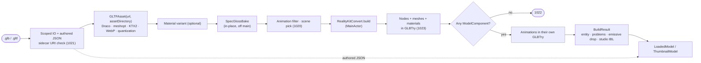

# glTF → RealityKit pipeline (RealityKit renderer)

How a `.glb` / `.gltf` becomes a RealityKit `Entity` in the RealityKit renderer (the default
`settings.preview.renderer`): the window canvas, Quick Look, Finder thumbnails, PNG exports and the
RealityKit pixel-diff goldens all go through it. With the WebKit renderer none of this runs — see
[`pipeline-web-renderer.md`](pipeline-web-renderer.md).

Everything here lives in the `RendererRealityKit` framework, the only target that links GLTFKit2
and DracoSwift. Entry points: `EntityLoader.load(from:)` / `loadThumbnail(from:)` in
`RendererRealityKit/EntityLoader.swift`, and `LoadedModel.switchingScene(to:from:)` in
`RendererRealityKit/LoadedModel+Host.swift`. Convert core: `RealityKitConvert` in
`RendererRealityKit/Convert/`.

The file is never rewritten. There is no temp GLB, no prepare pass and no retry layer: GLTFKit2
parses the file as authored, one in-place asset edit (spec-gloss) runs, and convert maps the asset
to RealityKit as the glTF spec says. Product heuristics that are not spec live in one place,
`RealityPolicy`, and every one of them is reported.

---

## Pipeline map

---

## 1 Open

`withSource(_:)` takes security-scoped access to the file **and** its folder (a sidecar `.gltf`
reads sibling buffers / images), reads the authored JSON (`GLBBox.peekJSON` for `.glb`,
`GLBBox.parseJSON` for `.gltf`) and refuses any external buffer / image URI that leaves the folder
(`..`, absolute, `file:` / `http(s):`) with **1021**. `data:` URIs are fine.

The authored JSON feeds the sidebar document (`GLTFDocumentJSON.makeDocument`, in `GLTFCore`),
`PreviewStats`, `PreviewDebugMode.available(from:)`, variant names and the report's
`extensionsUsed` / Draco flag. It describes the file as written, even where convert drops or
approximates something.

## 2 Parse (GLTFKit2)

`GLTFAsset(url:options: [assetDirectoryURLKey: folder])` on the original URL, off the main actor.
GLTFKit2 handles, with no help from us: Draco (`GLBDracoDecompressor`, found by class name),
`EXT_meshopt_compression`, KTX2 / BasisU (`newTexture`), `EXT_texture_webp` (ImageIO),
`KHR_mesh_quantization` and normalized accessors (`GLTFTransformPackedDataToFloat`), and names
unnamed nodes `NodeN`.

Then, still off the main actor:

- **Material variant** — `MaterialVariants.apply(variantIndex:to:)` when the host asks for one.
- **Spec-gloss** — `SpecGlossBake.apply(to:)` rewrites each `KHR_materials_pbrSpecularGlossiness`
  material in place to metal/rough + `KHR_materials_specular` (gltf-transform `metalRough()` math).
  Textured materials are baked (max edge 1024) into `GLTFImage(cgImage:)` textures; the bake is
  capped by `RealityPolicy.bakesSpecGlossTextures` (≤ 40 images, ≤ 24 textured spec-gloss
  materials), and a capped or failed bake falls back to factors. RealityKit cannot invert
  glossiness, so the bake is unavoidable.
- **Animation filter** — keep clips with `AnimationSampling.hasPositiveDuration` (drops 1-key
  "Default Take" clips); thumbnails drop all clips.
- **Scene pick** — `sceneIndex`, else the default scene; missing → **1020**.

## 3 Build (MainActor)

`RealityKitConvert.build(scene:asset:maxTextureEdge:)` returns a `BuildResult { entity, problems,
droppedBakedEmissive, studioIBLExponent }` — no static state, so window, Quick Look and thumbnail
loads in one process never see each other's problems. Lights are counted while converting nodes;
load and scene switch reuse that exponent instead of walking the entity.

1. Nodes, meshes, materials, lights and cameras convert inside one `GLBTry` (an ObjC exception →
   **1023**). Zero `ModelComponent`s → **1022**.
2. Animations convert afterwards in their **own** `GLBTry`. An exception there drops the clips
   (`droppedAnimations`) and keeps the meshes. Per-clip Swift errors are logged and skipped.

### Nodes

- Each entity gets a **unique** name: the glTF name, or `NodeN` from GLTFKit2, with `#<index>`
  appended to repeats. Skeleton paths and every clip's bind target use the same names, so clips on
  duplicate-named nodes bind (`unnamedAndDuplicateNamedAnimatedNodesAllMove`). The node index
  (`GLTFNodeIDComponent`) comes from a map built once per convert.
- `EXT_mesh_gpu_instancing`: one child entity per instance, sharing the node's `ModelComponent`.
  Instances are not document nodes, so hide / solo / selection act on the node.
- Punctual lights and spot cones go through `RealityLook` (see *Look mapping*).

### Meshes

Two paths, because `LowLevelMesh` has no joint semantics:

- **Static triangles → `LowLevelMesh`** (float3 layout, EXP-017). Tight float bufferViews are
  `memcpy`'d; anything else (strided, sparse, meshopt, quantized) gets one packed float copy.
  Bounds come from `min`/`max` for float positions, else from the data.
- **Skinned, morphed, POINTS → `MeshResource.Contents`** (packed SIMD accessors, EXP-006).
  POINTS become tiny cross triangles. Unsupported topologies → `droppedPrimitive`.

UVs: TEXCOORD_0 and TEXCOORD_1 as authored with V flipped (`.uv0` / `.uv1`; on the Contents path
UV1 needs macOS 27, else `missingTexCoord`). Nothing is baked into the UVs.

### Materials

`PhysicallyBasedMaterial` / `UnlitMaterial`, cached by `GLTFMaterial` identity (EXP-011).

- **Textures** — one `TextureResource` per (image, semantic); single channels (metallic B,
  roughness G, occlusion R, specular / opacity A, clearcoat) are read with `Texture.swizzle` on a
  `.raw` upload (`.raw` passes bytes through; `.scalar` would take a luminance). Opacity reuses the
  base-colour upload. KTX2 → `LowLevelTexture`. `Texture.uvIndex` = the texture's `texCoord`.
  Window / Quick Look bind a 1×1 placeholder per raster (same semantic) and
  `TextureResource.replace(using:options:)` after the first `SceneEvents.Update` (`rk textures
  final`); MASK/BLEND still CPU-decodes base colour for `alphaUsage`. Finder icons stay eager.
  `StillRenderer` waits for replace so exports match the final image.
- **`KHR_texture_transform`** → `textureCoordinateTransform` (UV0) /
  `secondaryTextureCoordinateTransform` (UV1). RealityKit applies it in image space (glTF's UV
  space, `T · R · S`), so offset and scale carry over and only the rotation sign flips
  (`TextureTransforms`). RealityKit has one transform per UV set: if textures on one set disagree,
  the base colour's wins (`approximatedTextureTransform`).
- **Alpha** — spec mapping: MASK → `opacityThreshold`; BLEND → transparent with factor × texture
  alpha. Then `RealityPolicy.blendOverride` for factor-1 BLEND (see *Policy*).
- **Transmission** → opacity approximation (`approximatedTransmission`); volume, iridescence,
  anisotropy, dispersion and diffuse transmission are reported as ignored extensions.

---

## Look mapping (`RealityLook`)

One file maps `RenderLook` and glTF light units to RealityKit, with constants from the look probes
(`.agents/research/2026-09-30-look-probes.md`):

| Value | RealityKit |
| --- | --- |
| Look yaw Y (0 = Khronos default view) | IBL entity yaw `π − Y` |
| Exposure EV, environment intensity E | IBL `intensityExponent = EV + log2 E` (+ policy dim) |
| Directional lux | × 591 |
| Point cd | lm = cd · 4π · 591 |
| Spot cd, cone half-angle | lm = cd · π · 591; RealityKit angle = 2 × half-angle |
| Emissive | 1:1 |

Exposure reaches the IBL only; punctual lights and emissive are not rescaled live. Stills
(`StillRenderer`) render into `.bgra8Unorm_srgb` and are tagged sRGB, so an sRGB 128 backdrop comes
out 128. Thumbnails, exports and the live canvas share `PreviewLighting.applyLook` (IBL entity with
yaw, or key + fill while the HDR loads / when the environment is off).

## Policy (`RealityPolicy`)

Non-spec product rules, defaults as shipped, each reported:

| Rule | Default | Reported as |
| --- | --- | --- |
| Studio IBL dim when the file has punctual lights | −2 EV | "File lights: on · Studio IBL: dimmed" |
| Factor-1 BLEND, texture alpha constant or no texture | opaque | `forcedOpaqueBlend` |
| Factor-1 BLEND, texture alpha span ≥ 0.15 | cutout at 0.4 (EXP-009) | `blendAsCutout` |
| Emissive that copies the albedo, or achromatic boost in a mostly-"baked" file (strength ≤ 1) | dropped | `droppedEmissive` + "Dropped baked / boost emissive" |
| Spec-gloss bake cap | ≤ 40 images, ≤ 24 textured materials | "Converted from KHR spec-gloss" (without "baked textures") |

The −2 EV dim was re-checked after the ×591 light fix: without it the file lights wash out on
`PointLightIntensityTest`.

---

## Outputs

`LoadedModel` (window / Quick Look):

| Field | Source |
| --- | --- |
| `entity` | `BuildResult.entity` |
| `stats`, `debugModes` | authored JSON |
| `document`, `materialVariantNames` | authored JSON (`GLTFDocumentJSON`) |
| `studioIBLExponent` | `BuildResult.studioIBLExponent` (counted while converting lights) |
| `pipelineReport` | spec-gloss / Draco / emissive drop / studio dim + `extensionsUsed` |
| `convertProblems` | `BuildResult.problems` + ignored extensions |

`ThumbnailModel` (Finder icons, pixel-diff harness): entity + studio exponent, no clips.
`RealityThumbnail` passes `maxTextureEdge: 1024` — a 512 px icon cannot show 4K texels, and it
measured −8 % icon time on the load corpus. Window / Quick Look convert is uncapped but deferred
(placeholders until first frame). Goldens stay on `loadThumbnail` (eager). Exports await replace.

Three honesty voices:

| Report | Question |
| --- | --- |
| `GLTFValidationState` | Is the **file** wrong? (async Khronos validator on the original URL, host only) |
| `PreparePipelineReport` | What did convert-time rewrites and policy change? |
| `ConvertProblemReport` | What did convert drop or approximate? Codes: `missingTexture`, `droppedPrimitive`, `missingTexCoord`, `ignoredExtension`, `approximatedTransmission`, `forcedOpaqueBlend`, `blendAsCutout`, `droppedAnimations`, `approximatedTextureTransform`, `droppedEmissive` |

## Scene switch and variants (host)

`LoadedModel.switchingScene(to:from:materialVariantIndex:)` re-reads and re-parses from disk (no
asset cache) and builds one scene. The host keeps the first load's document, stats and reports;
the studio exponent comes from convert (`BuildResult.studioIBLExponent`). A variant change runs a
full `load`.

---

## Key source files

| Area | Files |
| --- | --- |
| Orchestration | `RendererRealityKit/EntityLoader.swift` |
| Spec-gloss | `RendererRealityKit/SpecGlossBake.swift` |
| Convert | `RendererRealityKit/Convert/RealityKitConvert*.swift`, `RealityKitResourceContext.swift`, `TextureTransforms.swift`, `PackedAccessors.swift`, `AnimationHelpers.swift` |
| Look / policy | `RendererRealityKit/RealityLook.swift`, `RendererRealityKit/RealityPolicy.swift` |
| Variants | `RendererRealityKit/MaterialVariants.swift` |
| Reports | `RendererRealityKit/PreparePipelineReport.swift`, `RendererRealityKit/ConvertProblemReport.swift` |
| Document / JSON | `GLTFCore/GLTFDocumentJSON.swift`, `GLTFCore/GLBBox.swift` (read side) |
| Lighting / stills | `RendererRealityKit/PreviewLighting.swift`, `StillRenderer.swift`, `RealityThumbnail.swift`, `LiveStillRequest.swift` |
| Canvas | `RendererRealityKit/PreviewScene.swift`, `PreviewCamera.swift` |
| Tests | `GLTFInspectorTests/RealityKit/` (`PixelDiffRealityKitTests` goldens, `PrepareFreeInputsTests`, `InstancingTests`, `TextureTransformConvertTests`, …) |
