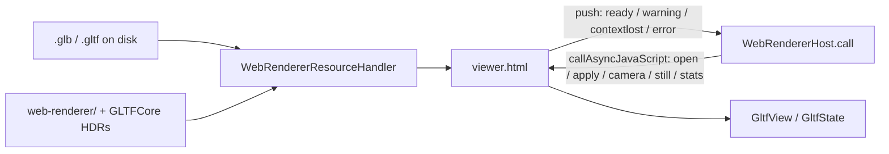

# glTF → WebKit (Khronos Sample Renderer)

How a file becomes pixels on the WebKit renderer. Every surface uses the same page
(`RendererWebKit/web-renderer/viewer.html`) inside a `WKWebView` owned by `WebRendererHost`.
All of it lives in the extension-safe `RendererWebKit` framework; the page ships once, inside
`RendererWebKit.framework`, and is found with `Bundle(for:)`. The HDRs come from `GLTFCore`
(`KhronosEnvironments.bundledURL`, served by name at `/environments/<stem>.hdr`).

This is **not** the RealityKit convert path: in WebKit mode no convert runs. The window's panels
read the file's JSON (`GLTFDocumentSummary`) — see
[`pipeline-gltf-to-realitykit.md`](pipeline-gltf-to-realitykit.md) for the other renderer.

---

## When to read this

| You need | Go here |
| --- | --- |
| Why WebKit, not RealityKit | [`decision-web-renderer.md`](decision-web-renderer.md) |
| What the page draws, and how Swift drives it | This file |
| How to catch a JS renderer regression | [`../TestModels/References/README.md`](../TestModels/References/README.md) |
| Update the vendored Khronos bundle | [Vendored bundle](#vendored-bundle) |

---

## Surfaces

| Surface | Swift side | Mode | Look |
| --- | --- | --- | --- |
| Document window | `WebDocumentWindow` → `WebPreviewCanvas` + `WebCanvasController` | `.live` | the window's viewport (`EngineLookBridge`) |
| Quick Look preview | `WebQuickLookController` (prestarted host) | `.live` | `Look.stored(showsFloor: true)` |
| Finder thumbnail | `WebThumbnail`, one warm `WebRendererHost` per process | `.still` | `Look.stored()` |

`.still` never adds the web view to a window. Pixels come from `canvas.toDataURL()` —
required for non-UI `QLThumbnailProvider`. `.live` runs a `requestAnimationFrame` loop in the
hosted view.

---

## Bridge

1. `WebRendererHost.start()` loads `gltf-inspector:///viewer.html?mode=still&size=512` (or
   `mode=live`). Mode and still size are read once, from the URL; the page posts `ready`.
2. `WebRendererResourceHandler` (`WKURLSchemeHandler`) serves the page, `libs/`, LUTs,
   `/environments/*.hdr`, and the model at `/model/<name>` (plus sidecar siblings for `.gltf`).
3. Swift calls five async page functions through one generic `call(fn, arg)`: the argument is
   `Encodable` JSON, the result is decoded from JSON, a JS throw becomes
   `WebRendererError.callFailed("<fn>: <page message>")`.

   | Page function | Swift | Returns |
   | --- | --- | --- |
   | `open({url})` | `load(model:)` | `LoadInfo` (triangles, meshes, timings, canvas size) |
   | `apply(look)` | `apply(_ look:)` | nothing; the whole `PageLook` |
   | `camera({op})` | `camera(.fit / .orbit / .pose / .get)` | `RendererCameraState` (pose + scene bounds) |
   | `still({size})` | `renderStillPNG(size:)`, `renderStill(size:)` | PNG data URL |
   | `stats()` | `stats()` | canvas size, triangles, page background (diagnostics, tests) |

4. The page pushes only events, never replies: `ready`, `warning` (every Khronos
   `console.error`, logged as `page warning`), `contextlost` and `error` (outside any call).
5. The store is a non-persistent `WKWebsiteDataStore`. Nothing is fetched from the network.

The Khronos renderer rejects **absolute** library and LUT URLs. Paths on the page stay
relative to the scheme root. Classic scripts before the module, or construction throws:
`libs/libktx.js` (global `createKtxModule`) and `libs/draco_wasm_wrapper_gltf.js` (global
`DracoDecoderModule`, which the sample viewer would otherwise fetch from a CDN).

---

## Look

The look is one value, `WebPreviewCanvas.Look`: the renderer-neutral `GLTFCore.RenderLook`
plus the canvas's view state (view mode, projection, field of view, scene, variant, floor,
centring, selection). It is sent **whole** on every change; the page keeps the last one and only
redoes the expensive parts when they changed: a new environment is prefiltered (IBL), centring
or scene refits, projection restates the orthographic size. Before the first model, `apply` only
records the HDR; `open` starts it after the model so first paint does not wait on IBL, and
`still` waits for it so a thumbnail is lit.

`PageLook` (`RendererWebKit/WebRendererLook.swift`) is the one mapping to page values:

| `RenderLook` | Page | Source |
| --- | --- | --- |
| yaw Y (degrees) | `environmentRotation` = 90 + Y — yaw 0 is the Khronos default view | measured (look probes) |
| exposure EV | `exposure` = 2^EV | measured |
| environment intensity E | `iblIntensity` = E | measured (1:1) |
| tone mapping | `toneMap` (raw value = Khronos name) | by definition |
| background | page background behind a transparent canvas | by definition |
| file lights, uses environment | not mapped: lights as authored, IBL always on | assumed |

Settings live in the App Group (`GLTFCore/AppGroupSettings.swift`). `Look.stored()` builds the
look from `AppGroupSettings.rendererLook()` (environment from `look.json`, tone map from the
suite) for Quick Look and the thumbnail, so both light a file the same way; the pixel-diff
goldens use yaw 0 as well (manifest rotation 90).

---

## Failure

- **Per-call timeout.** Every call (and the page start) has its own timeout
  (`WebRendererHost.timeout`, 15 s). A slow call fails alone; it never fails another one.
- **Dead page.** A WebContent crash (`webViewWebContentProcessDidTerminate`), a lost WebGL
  context (`webglcontextlost`) or an error outside any call fails every pending call and marks
  the host `isBroken`. The next `start()` loads a fresh page (a new WebContent process) instead
  of rethrowing the old error.
- **Canvas.** `WebCanvasController.phase` ends in `.failed(message)` when the page cannot start,
  rejects the file or times out before first paint (log: `viewport failed`, with the raw error).
  A page that dies after first paint is restarted once per model (log: `viewport restart`); a
  second death ends in `.failed`. The person sees `WebRendererError.userMessage` — friendly
  text, never the raw JS message. After first paint a failing look call is logged only.
- **Thumbnail.** A broken host, or one whose call timed out, is dropped so the next file gets a
  fresh page; the error goes back to Quick Look, which shows the generic icon.

---

## Window

`WebDocumentWindow` draws `WebPreviewCanvas` as soon as the file is opening; the canvas
region's state (`ShellRootView(canvasState:)`) follows the page, not the JSON panels. The
window holds one `WebCanvasController` across the shell's `.id(mountID)` remount; the next
mount adopts the running `WKWebView` (log: `viewport adopt`).

**Commands.** `FocusedPreviewCommands` (fit / preset / reset / screenshot → `CGImage`) is
registered by the mounted canvas; `EngineViewportController` forwards the View menu, Camera
pill and Export PNG to it. Fit is `camera(.fit)`; a preset is `camera(.fit)` then
`camera(.orbit)` with the preset's angles and a distance scaled from the page's fit by the
preset's visible extent; the screenshot is `still` at the live canvas size. The host owns the
save panel.

---

## Stills and the thumbnail reply

`renderStillPNG(size:)` returns the page's PNG bytes; the thumbnail writes them straight to the
reply file (no decode and re-encode). WebKit's encoder tags the PNG `sRGB` (asserted in
`WebRendererHostTests`). `renderStill` decodes the same bytes where pixels are needed (window
screenshot, pixel diff). The WebGL context keeps its drawing buffer only in still mode;
`still()` renders and reads back in one task.

Finder consumes `QLThumbnailReply(imageFileURL:)`. The CGContext drawing reply fails in Finder
with `QLThumbnailError 102`. Thumbnail and preview targets need
`com.apple.security.network.client` so WebKit can spawn its Networking XPC, even though the
page makes no network requests; without it WebContent dies and thumbnails fail with the same
`102`.

---

## Vendored bundle

`web-renderer/gltf-viewer.module.js` is an esbuild minify of the rollup build of
`KhronosGroup/glTF-Sample-Renderer` — not patched or forked. `web-renderer/VERSION` pins the
upstream commit (`863b981`, `main` at the 2026-08-24 build) and the sha256 of every vendored
file; `THIRD_PARTY_NOTICES.txt` keeps the licence banner the minify dropped, plus hdrpng, the
libs and Draco. `./scripts/vendor-web-renderer.sh` checks the files against `VERSION`
(`record` after an intentional update); its header has the rebuild recipe.

The bundle still contains PhysX glue and the `KHR_interactivity` engine. Stubbing them needs a
rebuild from source (`npm ci`), which this repo does not do; not measured.

---

## Measured and not adopted (seam 10.6, 2026-09-30, 3 runs each)

| Idea | Result | Verdict |
| --- | --- | --- |
| One shared `WKWebsiteDataStore.nonPersistent()` per process | first page 220–232 ms vs 228–260 ms per-host; later pages 70–86 vs 71–96 ms | no win beyond noise |
| Spare warm host in the app | would save a warm page start (~75 ms) for a second window; the first window starts its page with the app anyway | not worth an idle WebContent |
| Off-main / memory-mapped model reads (256 MB GLB, warm cache) | open 129–230 ms either way; worst main-thread gap 33–38 ms (read), 32–41 (mapped), 18–34 (off-main) | no clear win; `didReceive` still copies on main |

### First-paint experiments (EXP-001…016, 2026-09-30)

Gate: fresh-process `visibleMs` (page + IBL + load) or `stillMs` (first GPU frame + PNG) on
BoomBox and Corset, KEEP at ≥ 12 % faster with tiny not > 15 % slower. The wait is the page start,
not model parse: session-first ~1850 ms visible (page ~1170, IBL ~660), process-cold with WebKit
warm ~300–530 ms. Landed: IBL after the first frame (EXP-002, `iblMs` → 0), our module minified
6.1 → 3.2 MB (EXP-010), cached Finder icon under the live canvas (EXP-008), Quick Look page
prestart in `loadView` (EXP-009).

**Measured slower or flat — do not retry without a materially different approach:**

| Idea | Result |
| --- | --- |
| Peek the GLB/JSON before `loadGltf` to defer KTX/Draco (EXP-001) | peek cost ate the page save on Corset / tiny |
| Stub KTX/Draco, inject on decode miss (EXP-005) | −5 / −10 %, under the gate; not banned |
| Stream the bundle through `WKURLSchemeTask` in 64 KB chunks (EXP-004) | +10 / +13 %; one read is faster |
| `WKWebsiteDataStore.default()` for a compile cache (EXP-006) | first-process page slower |
| Official npm `@khronosgroup/gltf-viewer` 1.1.0 module (EXP-007) | older build, `stillMs` ~2×; minify ours instead |
| Shared live host for Quick Look remounts (EXP-003) | first spacebar unchanged; only a possible second-open win |
| `internalMSAA = 0`, `floatingPointFramebuffer = false`, `maxAnisotropy = 1`, skip first-bind `generateMipmap` (EXP-011…014) | flat or slower `stillMs` |
| Skip the unused first-init FBOs or the still-mode tonemap blit (EXP-015/016) | `stillMs` worse, up to ~2× |

---

## What this path does not do

- It does not convert materials to `PhysicallyBasedMaterial` or run any RealityKit prepare.
- It does not play clips, set morph weights, hide/solo nodes or toggle file lights
  (`WebPreviewCanvas.features`).
- It does not share one in-memory glTF parse between Swift and the page — the window's panels
  read the JSON and the page loads the file itself.
