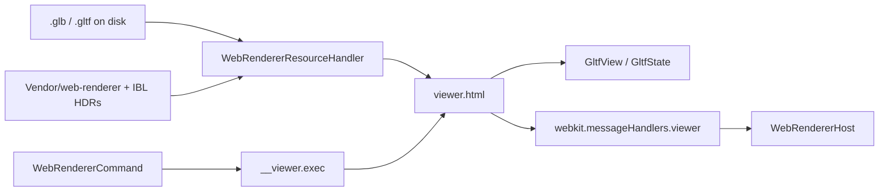

# glTF → WebKit (Khronos Sample Renderer)

How a file becomes pixels on this branch. Every surface uses the same page
(`Vendor/web-renderer/viewer.html`) inside a `WKWebView` owned by `WebRendererHost`.

This is **not** the RealityKit convert path. Convert still runs in the host for inspector
chrome — see [`pipeline-gltf-to-realitykit.md`](pipeline-gltf-to-realitykit.md).

---

## When to read this

| You need | Go here |
| --- | --- |
| Why WebKit, not RealityKit | [`decision-web-renderer.md`](decision-web-renderer.md) |
| What the page draws | This file |
| Sidebar / morphs / convert reports | [`pipeline-gltf-to-realitykit.md`](pipeline-gltf-to-realitykit.md) |
| How to catch a JS renderer regression | [`../TestModels/References/README.md`](../TestModels/References/README.md) |

---

## Surfaces

| Surface | Host | Mode | Loads convert? |
| --- | --- | --- | --- |
| Document window | `WebPreviewCanvas` in `PreviewView` | `.live` | Yes, in parallel — chrome only |
| Quick Look preview | `PreviewViewController` sets `webCanvasURL` | `.live` | No |
| Finder thumbnail | `ThumbnailProvider` + warm `WebRendererHost` | `.still` | No |

`.still` never adds the web view to a window. Pixels come from `canvas.toDataURL()` via the
`renderStill` command — required for non-UI `QLThumbnailProvider`. `.live` runs a
`requestAnimationFrame` loop in the hosted view.

---

## Byte path

1. `WebRendererHost` loads `gltf-inspector:///viewer.html` from the bundled renderer root.
2. `WebRendererResourceHandler` (`WKURLSchemeHandler`) serves the page, `libs/`, LUTs,
   `/environments/*.hdr`, and the model at `/model` (plus sidecar siblings for `.gltf`).
3. Swift sends JSON commands (`configure`, `setEnvironment`, `load`, look/camera, `renderStill`).
   The page echoes `id` on `result` / `failed`.
4. The store is a non-persistent `WKWebsiteDataStore`. Nothing is fetched from the network.

The Khronos renderer rejects **absolute** library and LUT URLs. Paths on the page stay
relative to the scheme root.

Classic scripts before the module, or construction throws:

- `libs/libktx.js` → global `createKtxModule`
- `libs/draco_wasm_wrapper_gltf.js` → global `DracoDecoderModule` (the sample viewer would
  otherwise hit a CDN)

---

## Shared look

Thumbnail, Quick Look, and a new document window must agree on lighting and tone mapping.

All settings live in the App Group `94A9N4B67S.lol.mattias.gltf-inspector`, which the host
and both extensions claim (`Shared/AppGroupSettings.swift`): `settings.*` keys in the group's
`UserDefaults` suite, `look.json` + custom `ibl/` in the group container.
`AppGroupSettings.rendererLook()` returns the environment catalog stem (from `look.json`) and
the Khronos tone-map name (from the suite). Each process registers the same fresh-install
defaults — `register(defaults:)` is per process.

The document window then applies the full live look through `EngineLookBridge` →
`WebPreviewCanvas.Look` (scene index, variant, selection, floor, wireframe, …).

---

## Host dual path

`HostShellRootView` sets `webCanvasURL` to the file as soon as it is opening. `PreviewView`
draws `WebPreviewCanvas` without waiting on convert.

In parallel, `PreviewView.State.loaded(from:)` still runs `EntityLoader.load` so
`HostSidebarModel` can build `GLTFSessionDocument` from **original JSON**
(`GLTFDocumentJSON`), and so morph / animation / scene-reload code that still talks to an
`Entity` has something to talk to.

Gaps that follow from that split (do not document as if they were done):

- Hide / solo apply to the RealityKit `Entity`, not the Khronos scene.
- Selection highlight is forwarded (`setSelectedNode`).
- Camera fit / PNG export that read `PreviewInteraction` can disagree with the web camera.

---

## Thumbnail reply

Finder consumes `QLThumbnailReply(imageFileURL:)`. The CGContext drawing reply works under
some `qlmanage` paths and fails in Finder with `QLThumbnailError 102`.

One warm host is reused per thumbnail-extension process (serialized). Cold folder-scale
start is much slower than a reuse on the same process.

Thumbnail and preview targets need `com.apple.security.network.client` so WebKit can spawn
its Networking XPC — even though the page makes no network requests. Without it, WebContent
dies and thumbnails fail with the same `102`.

---

## What this path does not do

- It does not convert materials to `PhysicallyBasedMaterial`.
- It does not run `MetalRoughPrepare` / `RealityPrepare` for pixels (those still run on the
  host convert path).
- It does not share one in-memory glTF parse between Swift and the page — the file is
  loaded twice in the document window (JSON/convert + WebKit).
